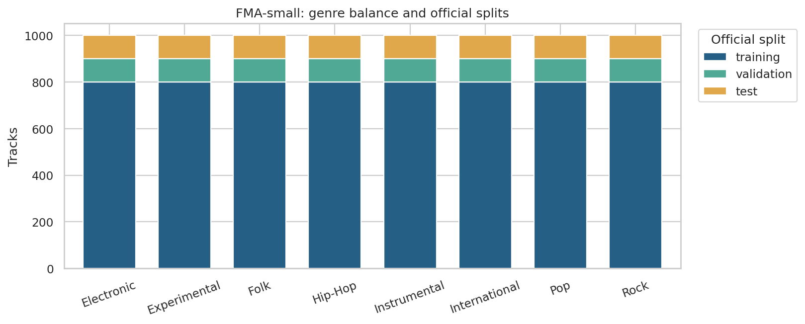
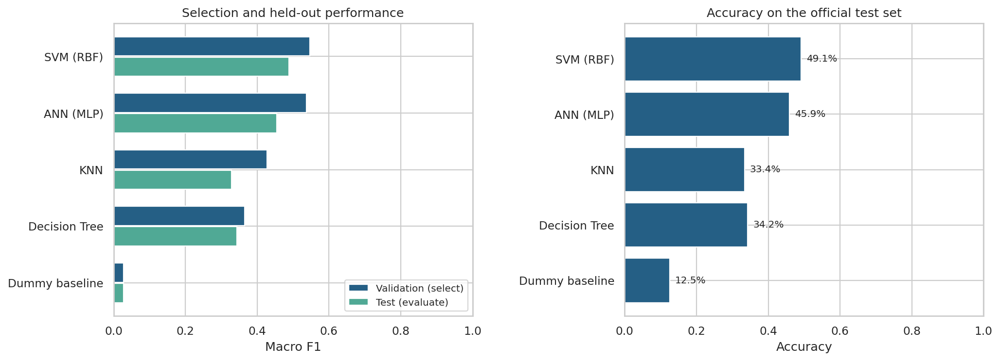
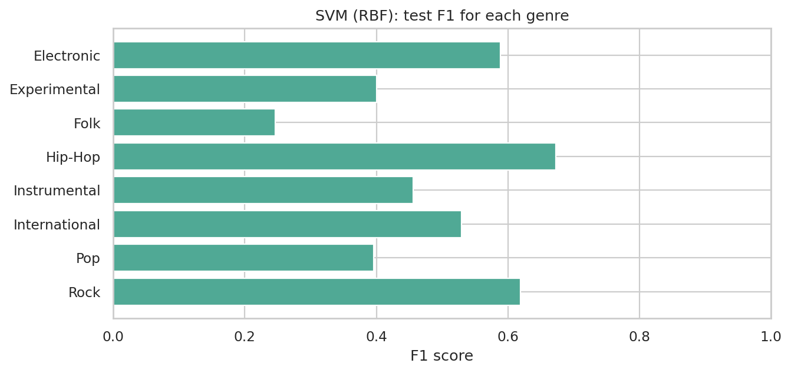
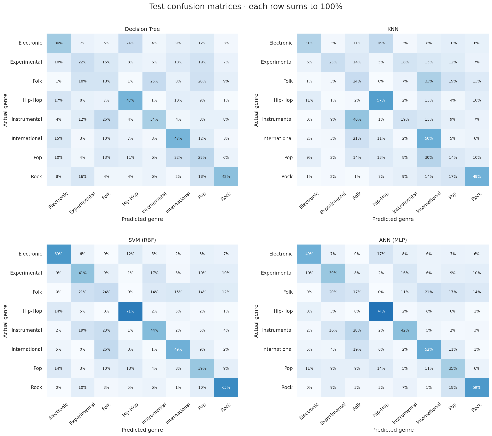
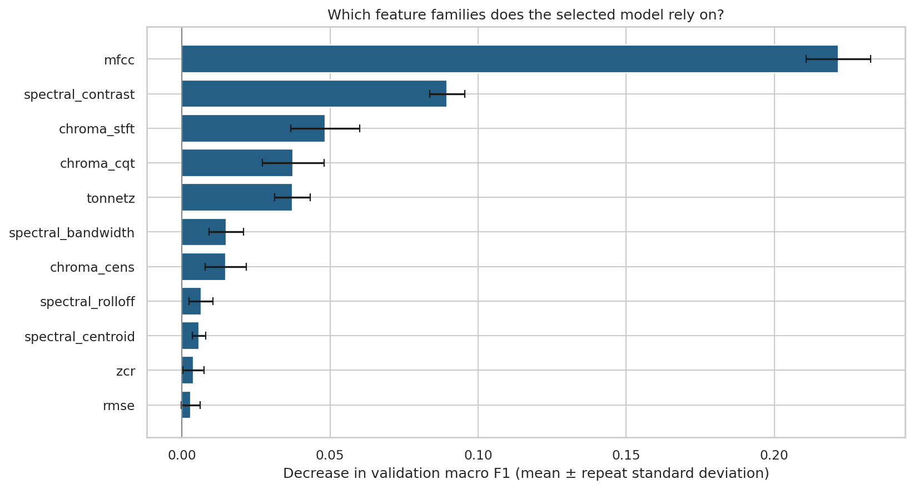
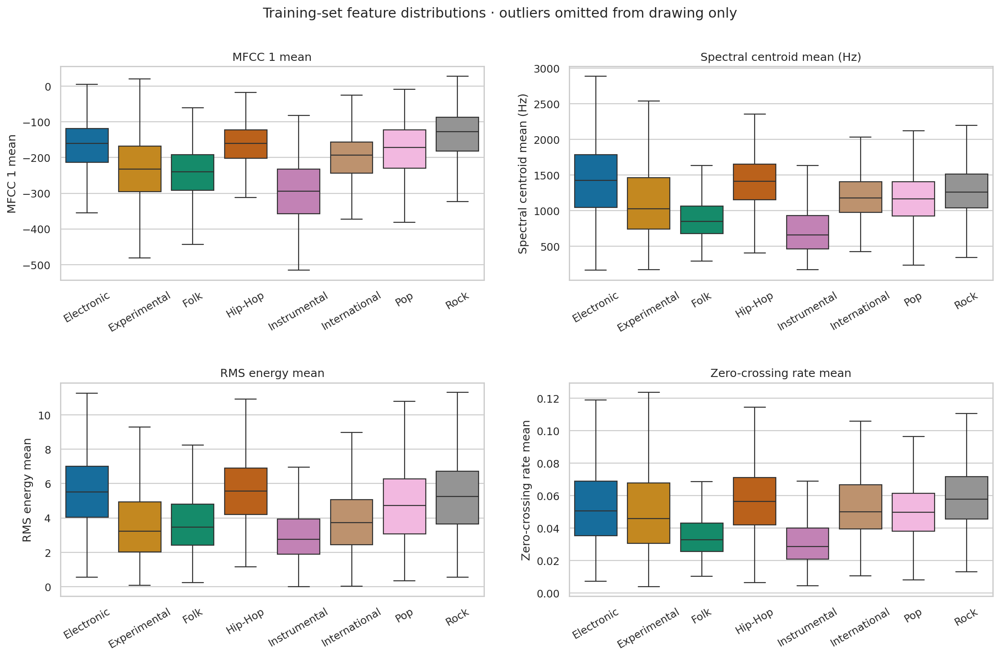
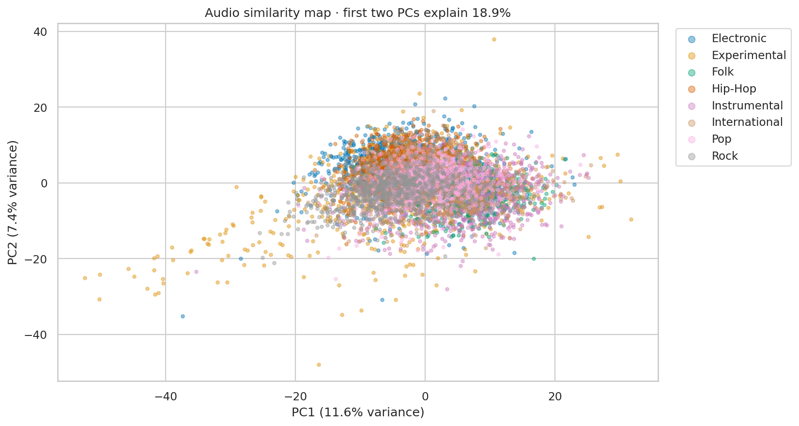
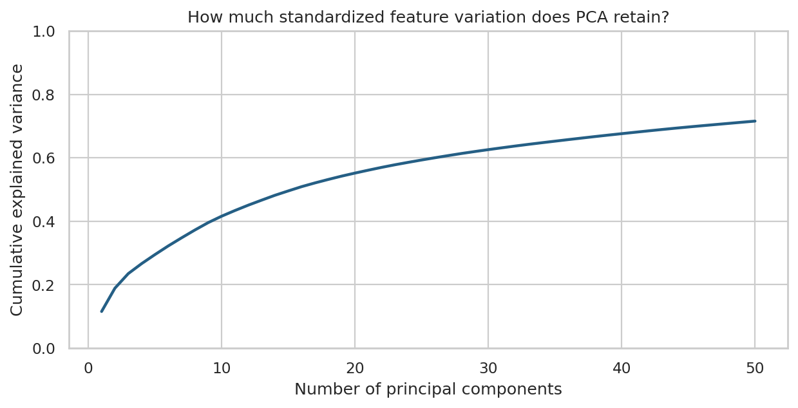
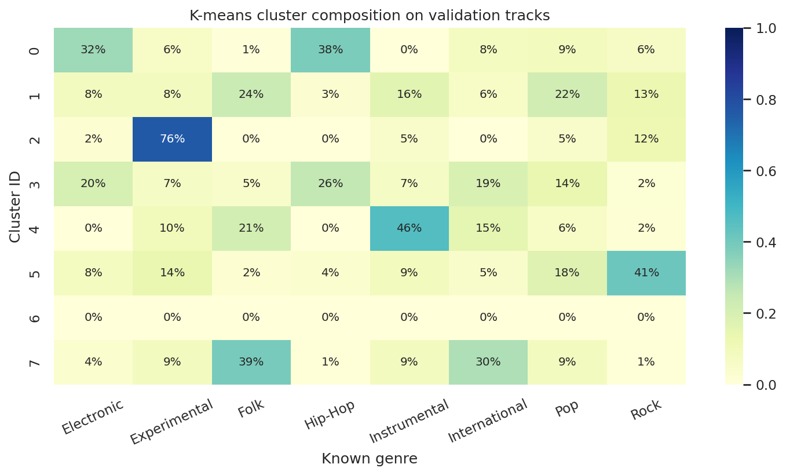

# MusicMap
## Music Genre Classification and Pattern Discovery Using Machine Learning

ML Laboratory Project

Student: [Enter your name]  
Roll number: [Enter your roll number]  
Department / institution: [Enter details]  
Course / instructor: [Enter details]

## Abstract

MusicMap investigates whether precomputed audio descriptors can distinguish music genres and reveal relationships between songs. The experiment uses 8,000 tracks from the balanced FMA-small subset, with eight genres and 518 numeric features. Decision Tree, K-nearest neighbors (KNN), radial-basis-function support vector machine (SVM), and a feed-forward artificial neural network (ANN) are compared with a majority-class baseline. The official artist-disjoint training, validation, and test partitions are preserved. Hyperparameters and the winning model are chosen using validation macro F1 before evaluating the test set. The selected model, SVM (RBF), achieves 49.12% test accuracy and 0.4885 test macro F1 in this run. PCA, K-means, nearest-neighbor retrieval, and grouped permutation importance provide complementary views of musical similarity and feature relevance. The findings describe this dataset and experimental configuration rather than universal genre boundaries.

## 1. Problem statement and objectives

Genre labels can help organize large music collections, but genres share instruments, production styles, and musical conventions. The project treats genre recognition as supervised multiclass classification: one feature vector is mapped to one of eight top-level genre labels.

The objectives are:

1. Prepare a manageable, reproducible dataset using audio features rather than downloading or decoding thousands of recordings.
2. Compare Decision Tree, KNN, SVM, and ANN on identical external partitions and report more than accuracy alone.
3. Identify audio feature families associated with genre separation.
4. Discover similarities through dimensionality reduction, clustering, and nearest-neighbor retrieval.

The research questions are which model performs best under this protocol, which genres it confuses, and whether audio-based clusters agree with the supplied labels.

## 2. Dataset and features

The source is FMA: A Dataset for Music Analysis by Defferrard, Benzi, Vandergheynst, and Bresson (ISMIR 2017). FMA-small contains 8,000 30-second track excerpts, balanced across Electronic, Experimental, Folk, Hip-Hop, Instrumental, International, Pop, and Rock. This project retains 8,000 tracks.

Only the official 342 MiB metadata archive is required. The 7.2 GiB FMA-small audio archive is unnecessary for these experiments. The published archive SHA-1 is verified as f0df49ffe5f2a6008d7dc83c6915b31835dfe733. The CSVs have multiple header rows; feature rows and metadata are joined by track ID, never by assumed row position.

| Partition   |   Tracks | Role                                   |
|:------------|---------:|:---------------------------------------|
| training    |     6400 | Fit candidate models and preprocessing |
| validation  |      800 | Choose hyperparameters and model       |
| test        |      800 | Final held-out evaluation              |

Each genre contributes 800 training, 100 validation, and 100 test tracks. The recorded overlap counts for artist IDs are {'training__validation': 0, 'training__test': 0, 'validation__test': 0}; missing artist IDs: 0. Thus this prepared release has no artists shared across partitions.

The 518 descriptors belong to 11 audio feature families. For each feature dimension, the dataset provides mean, standard deviation, skewness, kurtosis, median, minimum, and maximum over analysis frames. Predictors contain audio descriptors only. Titles, track IDs, artist IDs, album IDs, genre labels, and split labels are kept separately and never enter classifiers.

| Family             |   Columns | Meaning                                                           |
|:-------------------|----------:|:------------------------------------------------------------------|
| chroma_cens        |        84 | Smoothed pitch-class energy; harmonic content                     |
| chroma_cqt         |        84 | Constant-Q pitch-class energy; harmonic content                   |
| chroma_stft        |        84 | STFT pitch-class energy; harmonic content                         |
| mfcc               |       140 | Mel-frequency cepstral coefficients; timbre and spectral envelope |
| rmse               |         7 | Root mean square energy; signal energy                            |
| spectral_bandwidth |         7 | Spread of spectral energy around its centroid                     |
| spectral_centroid  |         7 | Centre of spectral energy; brightness                             |
| spectral_contrast  |        49 | Peak-to-valley differences in spectral bands                      |
| spectral_rolloff   |         7 | Frequency below which most spectral energy lies                   |
| tonnetz            |        42 | Tonal centroid coordinates; harmonic relationships                |
| zcr                |         7 | Zero-crossing rate; noisiness and rapid signal changes            |

For example, "mfcc__mean__01" means the temporal mean of the first MFCC coefficient. The table has no explicit tempo/BPM feature; this project does not claim to measure tempo directly.

Data-quality checks found 0 non-finite feature values, 0 tracks requiring partial imputation, and 0 completely missing feature rows. Stored features use float32 to reduce memory. Prepared files also have SHA-256 integrity checks.

## 3. Experimental methodology

### 3.1 Preprocessing and leakage prevention

Candidate fitting uses the 6,400 official training tracks. Each scikit-learn pipeline contains median imputation, removal of constant columns, standard scaling, and a classifier. Imputation and scaling are fitted inside the pipeline on training data. The transformation is z = (x − training mean) / training standard deviation. Scaling matters especially for distance-based KNN, SVM, and ANN; applying it to a tree is harmless.

The current subset has complete features, so imputation does not change it. The same implementation can handle partially missing values. Entirely unusable rows are explicitly recorded if encountered during preparation.

All 518 input descriptors are available to each classifier. PCA is used for exploratory analysis and similarity retrieval, not as classifier preprocessing. No feature ranking is used to select predictors after viewing test results.

### 3.2 Model comparison and selection

The "standard" profile evaluates 21 candidates including the baseline. In the standard profile, the grids are:

- Decision Tree: maximum depth in 10, 20, or unlimited; minimum leaf size in 2 or 5 (6 candidates).
- KNN: k in 5, 15, or 31; uniform or inverse-distance votes (6 candidates).
- RBF SVM: C in 1 or 10; gamma equal to the training-data scale heuristic or 0.001 (4 candidates).
- ANN: one 128-unit layer or two layers of 128 and 64 units; L2 alpha in 0.0001 or 0.01 (4 candidates).
- Dummy baseline: always predict the most frequent training label (1 candidate).

The ANN is a feed-forward multilayer perceptron trained with Adam, ReLU activation, batch size 128, initial learning rate 0.001, and at most 200 epochs. It uses an internal 10% holdout for early stopping, with patience of 15 epochs. That internal holdout is a random track split within the current fitting partition; the official external validation and test sets remain artist-disjoint. The ANN encodes genre strings numerically during fitting and decodes predictions back to text.

Each algorithm's hyperparameters are chosen by macro F1 on the official 800-track validation set. Validation accuracy breaks ties; an exact tie retains the first grid candidate. The winning algorithm is also chosen by validation macro F1. Selection is saved to "selection.json" before test features or labels are requested. Each selected configuration is then freshly fitted on the combined 7,200 training and validation tracks; ANN early stopping still reserves 10% internally. These refitted models are evaluated once on the 800-track test set. The baseline is reported for context and is excluded from the four-model winner selection.

There is no cross-validation in this baseline experiment. A fixed official validation partition provides an affordable laptop workflow. Candidate scores are available in "candidate_results.csv", and all final test predictions are saved in "test_predictions.csv".

### 3.3 Algorithms

- Decision Tree learns threshold rules that reduce Gini impurity. It captures nonlinear interactions and is interpretable, but deep trees can overfit.
- KNN assigns a label from nearby standardized feature vectors using Euclidean distance. It is simple but sensitive to scaling, redundant features, and high dimensionality.
- SVM learns separating boundaries in an RBF feature space. Its kernel is exp(−gamma × squared Euclidean distance); C controls the penalty for misclassification.
- ANN learns nonlinear combinations of descriptors through fully connected layers. Regularization and early stopping limit overfitting, but results can vary with initialization.

Selected hyperparameters:

| Model         | Selected hyperparameters                           |
|:--------------|:---------------------------------------------------|
| Decision Tree | {"max_depth": 10, "min_samples_leaf": 5}           |
| KNN           | {"n_neighbors": 5, "weights": "distance"}          |
| SVM (RBF)     | {"C": 1.0, "gamma": 0.001}                         |
| ANN (MLP)     | {"alpha": 0.0001, "hidden_layer_sizes": [128, 64]} |

### 3.4 Evaluation metrics

Accuracy is the fraction of correctly classified tracks. For a genre, precision is TP / (TP + FP), recall is TP / (TP + FN), and F1 is 2 × precision × recall / (precision + recall). Macro F1 averages per-genre F1 with equal weight for every genre. Balanced accuracy is mean recall. Undefined precision or F1 is assigned zero.

The test partition is balanced, so balanced accuracy equals accuracy here. Confusion matrices show which genres are mistaken for which others. Validation scores measure training-only candidates; test scores measure their refitted versions, so the columns refer to different fitted models on different partitions.

## 4. Results

The algorithm selected before test evaluation is **SVM (RBF)**. Its test accuracy is **49.12%** and macro F1 is **0.4885**. The dummy baseline reaches 12.50% accuracy and 0.0278 macro F1.

| Model          |   Validation F1 | Test accuracy   |   Test precision |   Test recall |   Test F1 |
|:---------------|----------------:|:----------------|-----------------:|--------------:|----------:|
| SVM (RBF)      |          0.5464 | 49.12%          |           0.4878 |        0.4912 |    0.4885 |
| ANN (MLP)      |          0.5364 | 45.88%          |           0.4534 |        0.4587 |    0.4546 |
| KNN            |          0.4270 | 33.38%          |           0.3542 |        0.3337 |    0.3287 |
| Decision Tree  |          0.3656 | 34.25%          |           0.3488 |        0.3425 |    0.3437 |
| Dummy baseline |          0.0278 | 12.50%          |           0.0156 |        0.1250 |    0.0278 |

The model ordering follows validation macro F1. A higher test score from another model would be a descriptive observation, not a reason to change the preselected winner. These are actual measurements from the included run; scores from a different machine or dependency version may differ slightly.

### 4.1 Per-genre performance

| Genre         |   Precision |   Recall |     F1 |   Test tracks |
|:--------------|------------:|---------:|-------:|--------------:|
| Electronic    |      0.5769 |   0.6000 | 0.5882 |           100 |
| Experimental  |      0.3905 |   0.4100 | 0.4000 |           100 |
| Folk          |      0.2526 |   0.2400 | 0.2462 |           100 |
| Hip-Hop       |      0.6396 |   0.7100 | 0.6730 |           100 |
| Instrumental  |      0.4731 |   0.4400 | 0.4560 |           100 |
| International |      0.5765 |   0.4900 | 0.5297 |           100 |
| Pop           |      0.4021 |   0.3900 | 0.3959 |           100 |
| Rock          |      0.5909 |   0.6500 | 0.6190 |           100 |

The largest off-diagonal confusion counts for the selected model are:

| Actual genre   | Predicted genre   |   Tracks |
|:---------------|:------------------|---------:|
| International  | Folk              |       26 |
| Instrumental   | Folk              |       23 |
| Folk           | Experimental      |       21 |
| Instrumental   | Experimental      |       19 |
| Experimental   | Instrumental      |       17 |

Each confusion-matrix row is normalized by its actual genre count. These errors show overlap in the supplied acoustic representation; they do not prove that a genre label is wrong.

### 4.2 Computation and reproducibility

| Model          |   Candidate fitting (s) |   Final refit (s) |   Test prediction (s) |
|:---------------|------------------------:|------------------:|----------------------:|
| SVM (RBF)      |                 18.3601 |            4.4288 |                1.0982 |
| ANN (MLP)      |                  7.1013 |            1.7027 |                0.0066 |
| KNN            |                  1.5029 |            0.3108 |                0.0875 |
| Decision Tree  |                 21.7439 |            3.5446 |                0.0055 |
| Dummy baseline |                  0.2445 |            0.2577 |                0.0056 |

The full tuning/refitting/evaluation stage took 75.9 seconds in the execution environment, using a limit of 2 numerical-library threads and seed 42. Times exclude downloading, preparation, visualization, and report generation. Candidate fitting time sums fitting only; prediction and other overhead account for the remaining elapsed time. This timing is not a laptop performance guarantee.

The run used Python 3.12.14 and scikit-learn 1.8.0. Exact direct dependency versions are recorded in "requirements-tested.txt"; runtime details are in "run_info.json". A fixed seed improves repeatability but does not establish robustness across random seeds.

Fitting diagnostics:

No fitting warnings were recorded.

## 5. Feature interpretation

The selected training-only model is evaluated on validation tracks. One entire feature family is jointly shuffled across tracks while all other families remain unchanged. The drop in macro F1 estimates how much this fitted model relies on that family. Joint shuffling preserves correlations among columns within the family. Each family uses 5 repeated permutations with a fixed seed.

| Family             |   Columns |   Mean F1 drop |   Repeat SD |
|:-------------------|----------:|---------------:|------------:|
| mfcc               |       140 |         0.2217 |      0.0109 |
| spectral_contrast  |        49 |         0.0895 |      0.0059 |
| chroma_stft        |        84 |         0.0484 |      0.0116 |
| chroma_cqt         |        84 |         0.0375 |      0.0104 |
| tonnetz            |        42 |         0.0373 |      0.0060 |
| spectral_bandwidth |         7 |         0.0149 |      0.0059 |
| chroma_cens        |        84 |         0.0148 |      0.0069 |
| spectral_rolloff   |         7 |         0.0064 |      0.0041 |
| spectral_centroid  |         7 |         0.0057 |      0.0023 |
| zcr                |         7 |         0.0040 |      0.0035 |
| rmse               |         7 |         0.0030 |      0.0032 |

The leading families in this run are mfcc, spectral_contrast, chroma_stft. The audio meanings of these families are listed in Section 2. Positive drops indicate reliance; near-zero or negative drops can reflect redundancy, sampling variation, or features that the model does not use effectively. The error bars show variability across permutations, not confidence intervals across new datasets. Family sizes differ, and correlated families can substitute for one another, so the ranking is neither causal nor an equal-size feature comparison.

Individual descriptors can also be ranked by a training-only one-way ANOVA F score:

| Descriptor                    |   Training ANOVA F |
|:------------------------------|-------------------:|
| mfcc__mean__01                |           306.9543 |
| mfcc__median__01              |           305.9203 |
| spectral_contrast__median__02 |           269.0754 |
| spectral_contrast__mean__02   |           265.7206 |
| mfcc__mean__03                |           256.9555 |
| spectral_contrast__mean__04   |           253.6100 |
| spectral_contrast__median__04 |           251.7100 |
| mfcc__median__03              |           250.8509 |
| spectral_rolloff__mean__01    |           249.5471 |
| spectral_contrast__median__03 |           248.5839 |

This ranking is an exploratory association measure. It ignores multivariate interactions and correlated predictors, and it is not a multiple-testing-adjusted significance claim or a feature-selection step.

Boxes show medians and interquartile ranges. Outlier points are omitted only from the drawing; they remain in the training data. Overlapping distributions explain why no single simple descriptor is expected to identify every genre.

## 6. Pattern discovery and song similarity

### 6.1 PCA music map

Preprocessing and PCA are fitted only on training audio features. Training and validation tracks are projected into that space; genre labels are added only as display colors. The first two principal components retain 18.91% of standardized feature variance, and the first 50 retain 71.59%.

Open "song_map.html" for the offline interactive map: hover for track details, filter genres through the legend, and zoom. Nearby points share aspects of their measured audio descriptors. Since two dimensions discard information, separation or overlap in this drawing is not a classifier accuracy result.

### 6.2 K-means clustering

K-means uses the training-set 50-dimensional PCA representation and k = 8, fixed in advance to match the number of known genres. It does not use genre labels during fitting. Validation tracks receive the nearest learned cluster centroid.

- Adjusted Rand index against validation genres: 0.1403.
- Normalized mutual information against validation genres: 0.2244.
- Validation silhouette score in PCA space: 0.04055146872997284.

ARI measures agreement after accounting for chance, NMI measures shared label information, and silhouette measures geometric compactness/separation. Cluster numbers are arbitrary and cannot be interpreted as genre IDs. A cluster can contain multiple genres, and one genre can span multiple clusters.

The validation metrics and composition chart are descriptive; they are not used to tune k or select a classifier. Test tracks are excluded from discovery analyses.

### 6.3 Nearest songs

Euclidean distance in the training-fitted 50-dimensional PCA space retrieves similar tracks from the training catalog. The query itself and tracks with the same artist ID are excluded by default. Genre labels are shown for interpretation and are not part of the distance.

For validation query ID 148, "Blackout 2" by Contradiction (Experimental), the five nearest eligible training tracks are:

|   track_id | title                              | artist              | genre      |   distance |
|-----------:|:-----------------------------------|:--------------------|:-----------|-----------:|
|      12537 | Maree Lunaire                      | Smoking After       | Pop        |    14.8261 |
|     127297 | The Pursuit of Unintentional Humor | Oh Yeah, the Future | Pop        |    15.1386 |
|     145730 | STOCKPILE! (Funky Dubb Mixx)       | LOWdown             | Hip-Hop    |    15.1609 |
|     113972 | Your Pulse                         | Little Glass Men    | Electronic |    15.2266 |
|      98838 | intense                            | Moonove             | Electronic |    15.5473 |

Distances are representation-specific values, not probabilities or listener-preference scores. This is an audio similarity demonstration rather than a personalized recommendation system.

## 7. Discussion and limitations

1. The four algorithms receive the same external partitions, but their small hyperparameter grids do not establish the best possible performance for each model family.
2. Artist-disjoint splits reduce artist memorization. They do not remove every potential recording, production, album, or dataset-specific correlation.
3. Genre boundaries are subjective and sometimes overlapping. This task uses one top-level label per track and only eight FMA-small genres.
4. Summary descriptors discard musical sequence and detailed temporal structure. The model does not directly process waveforms or learn from spectrograms.
5. The ANN uses an internal track-level early-stopping split, one initialization seed, and at most 200 epochs. Repeated artist-aware experiments could change the comparison.
6. Standard scaling can remain sensitive to extreme values. PCA maximizes variance rather than genre discrimination, and the 2D map discards most dimensions.
7. Grouped permutation importance describes reliance of one tuned model on one validation set. The validation partition has already influenced model selection, so it is not an independent confirmatory interpretation dataset.
8. Results come from a single official holdout protocol. A larger evaluation or repeated group-aware validation would better quantify uncertainty.
9. Predicting a genuinely new audio file requires compatible extraction of the same descriptors. The delivered predictor accepts prepared FMA feature rows or a matching flat feature CSV; raw MP3 feature extraction is outside this implementation.

## 8. Conclusion and future work

MusicMap provides a reproducible comparison of Decision Tree, KNN, SVM, and ANN for feature-based music genre classification. Under the recorded protocol, SVM (RBF) was selected on validation data and obtained 49.12% test accuracy with 0.4885 macro F1. The feature analysis highlights mfcc, spectral_contrast, chroma_stft, while PCA, K-means, and nearest-neighbor retrieval reveal relationships that are only partly aligned with genre labels.

Future experiments can use artist-grouped cross-validation within the training partition, multiple ANN seeds, carefully validated feature selection, broader genres, or pretrained audio embeddings. Any such changes should be selected without reusing this test set for tuning.

## 9. Reproduction and deliverables

From the project directory, install the requirements and run:

~~~sh
python -m pip install -r requirements-tested.txt
musicmap run --profile standard --seed 42 --threads 2
jupyter lab notebooks/MusicMap.ipynb
~~~

The notebook defaults to displaying the included results. Set its RUN_TRAINING and RUN_DISCOVERY switches to True to recompute. Prepared subset data are bundled in the complete package; if absent, preparation downloads the official metadata archive automatically. No audio download or GPU is required.

Deliverables include the Python package, executed notebook, metric tables, all test predictions, selected model, interactive map, figures, this report in Markdown/HTML/Word, a presentation outline, and viva preparation notes. Fill in the student and institution fields and adapt the report to the instructor's required format.

## References and attribution

1. Defferrard, M., Benzi, K., Vandergheynst, P., and Bresson, X. (2017). FMA: A Dataset for Music Analysis. Proceedings of the 18th International Society for Music Information Retrieval Conference. https://arxiv.org/abs/1612.01840
2. Official FMA repository and release documentation: https://github.com/mdeff/fma
3. Official audio descriptor extraction implementation: https://github.com/mdeff/fma/blob/master/features.py
4. Scikit-learn user guide and API documentation: https://scikit-learn.org/stable/

FMA metadata and derived feature data are attributed to Defferrard et al. and distributed under CC BY 4.0: https://creativecommons.org/licenses/by/4.0/. This project uses the original 2017 metadata release and does not redistribute audio recordings.
