# MusicMap
## Music Genre Classification and Pattern Discovery Using Machine Learning

Machine Learning Course Project

Student: Akshat Tikaria — Roll number: 241070005

Student: Aniket Shinde — Roll number: 171070977

Institution: Veermata Jijabai Technological Institute (VJTI)

Course: Machine Learning

## Abstract

MusicMap investigates whether precomputed audio descriptors can identify a track's music genre and reveal relationships between songs. It uses the 8,000 tracks of the balanced FMA-small dataset (eight genres, 518 numeric descriptors per track) and keeps the official artist-disjoint training, validation and test partitions. 9 candidate models — Stacked Ensemble, Gradient Boosting, Soft-voting Ensemble, ANN (MLP), SVM (RBF), Extra Trees, Logistic Regression, KNN, Decision Tree — are tuned with artist-grouped cross-validation and compared against a majority-class baseline. The validation-selected model, **Stacked Ensemble**, reaches **50.38% test accuracy** (random top-1 chance: 12.5%) and **0.4987 macro F1**, with the correct genre among its top three guesses for 80.4% of tracks (random top-3 chance: 37.5%). PCA, K-means clustering, nearest-neighbour retrieval and grouped permutation importance provide complementary views of musical similarity and of which audio properties matter. The findings describe this dataset and protocol rather than universal genre boundaries.

## 1. Problem statement and objectives

Genre labels help organize and recommend music, but genres share instruments, production styles and conventions. MusicMap treats genre recognition as supervised multiclass classification: one descriptor vector is mapped to one of eight top-level genres.

Objectives:

1. Prepare a reproducible dataset from published audio descriptors, without downloading 7.2 GiB of audio.
2. Compare the required algorithms (Decision Tree, KNN, SVM, ANN) with stronger modern baselines (Logistic Regression, Extra Trees, Gradient Boosting) and a soft-voting ensemble, using training-fitted preprocessing and artist-disjoint outer evaluation.
3. Report more than accuracy: macro F1, per-genre errors, top-3 accuracy, confidence and uncertainty.
4. Identify the audio feature families that drive the predictions.
5. Discover structure through dimensionality reduction, clustering and nearest-song retrieval.

## 2. Dataset and features

The source is *FMA: A Dataset for Music Analysis* (Defferrard, Benzi, Vandergheynst and Bresson, ISMIR 2017). FMA-small contains 8,000 30-second excerpts balanced across Electronic, Experimental, Folk, Hip-Hop, Instrumental, International, Pop and Rock. Only the 342 MiB metadata archive is needed; its published SHA-1 (f0df49ffe5f2a6008d7dc83c6915b31835dfe733) is verified before reading. Feature rows and metadata are joined by track ID, never by row position.

| Partition   |   Tracks | Role                                       |
|:------------|---------:|:-------------------------------------------|
| training    |     6400 | Artist-grouped CV tuning; ensemble weights |
| validation  |      800 | Choose the champion                        |
| test        |      800 | Final held-out evaluation                  |

Each genre contributes 800 training, 100 validation and 100 test tracks. Shared artists between partitions: training/validation = 0, training/test = 0, validation/test = 0 — no artist appears in more than one partition.

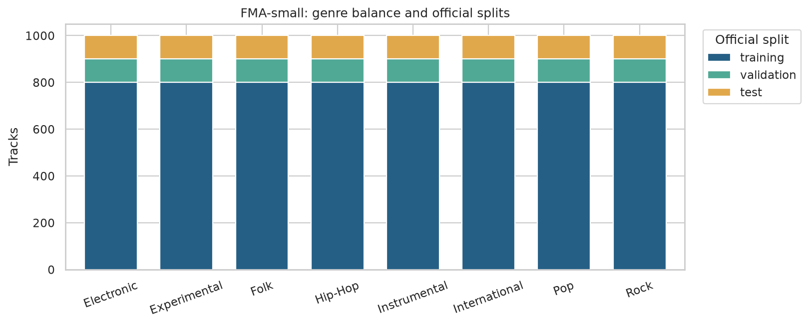

The 518 descriptors summarize 74 frame-level feature dimensions using seven statistics each (74 × 7 = 518), grouped into 11 audio feature families. The statistics over time are: mean, standard deviation, skewness, kurtosis, median, minimum and maximum. Only audio descriptors enter the classifiers; title, artist, album, genre and split are kept separate.

| Family             |   Columns | Meaning                                                           |
|:-------------------|----------:|:------------------------------------------------------------------|
| chroma_cens        |        84 | Smoothed pitch-class energy; harmonic content                     |
| chroma_cqt         |        84 | Constant-Q pitch-class energy; harmonic content                   |
| chroma_stft        |        84 | STFT pitch-class energy; harmonic content                         |
| mfcc               |       140 | Mel-frequency cepstral coefficients; timbre and spectral envelope |
| rmse               |         7 | Root mean square energy; signal energy                            |
| spectral_bandwidth |         7 | Spread of spectral energy around its centroid                     |
| spectral_centroid  |         7 | Centre of spectral energy; brightness                             |
| spectral_contrast  |        49 | Peak-to-valley differences in spectral bands                      |
| spectral_rolloff   |         7 | Frequency below which most spectral energy lies                   |
| tonnetz            |        42 | Tonal centroid coordinates; harmonic relationships                |
| zcr                |         7 | Zero-crossing rate; noisiness and rapid signal changes            |

For example, "mfcc__mean__01" is the temporal mean of the first MFCC coefficient. There is no explicit tempo feature. Data checks found 0 non-finite values and 0 unusable rows.

## 3. Experimental methodology

### 3.1 Preprocessing and leakage prevention

Every candidate is a single scikit-learn pipeline: **median imputation → constant-column removal → standard or quantile-to-normal scaling → optional ANOVA feature selection or PCA → classifier**. The whole pipeline is refitted within every outer fitting fold, so held-out outer-fold tracks do not determine the median, scale, quantiles, selected features or principal directions. The quantile transform maps each descriptor to a normal distribution using training ranks, which tames the heavy tails present in many FMA statistics (kurtosis and max columns in particular).

### 3.2 Artist-grouped cross-validation

All tuning uses 3-fold **StratifiedGroupKFold** inside the official 6,400-track training partition, with artist ID as the group. No artist appears on both sides of any fold (audited in "cv_splits.json"), which mirrors the artist-disjoint official split and reduces evaluation gains from recognizing an artist already seen during fitting. Each configuration is scored by mean fold macro F1; the fold standard deviation describes variability across these folds (it is not a confidence interval). Fits run in parallel worker processes.

| Model family        |   Configurations |   Best CV macro F1 |   Fit time (s) |
|:--------------------|-----------------:|-------------------:|---------------:|
| Decision Tree       |                6 |             0.3478 |        35.8760 |
| KNN                 |               12 |             0.4233 |        19.9699 |
| SVM (RBF)           |               12 |             0.5410 |       116.7107 |
| ANN (MLP)           |                9 |             0.5045 |       145.9023 |
| Logistic Regression |                8 |             0.5115 |        38.1600 |
| Extra Trees         |                4 |             0.5009 |       295.8909 |
| Gradient Boosting   |                4 |             0.5387 |       607.0723 |
| Dummy baseline      |                1 |             0.0277 |         0.5396 |

In total 56 configurations were evaluated (168 fold fits), plus the probability refits, ANN seed runs and final refits.

### 3.3 Model families

- **Decision Tree** – axis-aligned threshold rules; interpretable but high-variance.
- **KNN** – inverse-distance vote among the nearest training tracks, optionally in an ANOVA or PCA subspace.
- **SVM (RBF)** – maximum-margin classifier in an RBF kernel space; C controls regularization. Platt scaling supplies class probabilities for the ensemble.
- **ANN (MLP)** – feed-forward ReLU network trained with Adam, L2 regularization and early stopping on a 10% internal holdout. The selected architecture is retrained with 5 predeclared seeds (42, 43, 44, 45, 46) and their probabilities are averaged; no seed is cherry-picked.
- **Logistic Regression** – a regularized linear (multinomial) model; a linear reference whose probability calibration would require separate evaluation.
- **Extra Trees** – an average of 500 extremely randomized trees.
- **Gradient Boosting** – LightGBM: 500 small trees added sequentially, each fitted to the remaining errors of the previous ones, with a 0.03 learning rate, row/feature subsampling and L2 regularization.
- **Dummy baseline** – always predicts the most frequent training genre (12.5% accuracy on balanced data).

Artist grouping applies to the outer CV and official partitions. The ANN's internal 10% early-stopping split and SVM's internal probability estimation do not receive artist groups; these internal mechanisms should not be described as artist-disjoint.

Selected configuration for each family:

| Model                |   CV macro F1 | Selected settings                                                                                                                                                  |
|:---------------------|--------------:|:-------------------------------------------------------------------------------------------------------------------------------------------------------------------|
| Decision Tree        |        0.3478 | standard scaling, max_depth=8, min_samples_leaf=5                                                                                                                  |
| KNN                  |        0.4233 | standard scaling, ANOVA top 128, n_neighbors=15, weights=distance                                                                                                  |
| SVM (RBF)            |        0.5410 | quantile scaling, ANOVA top 256, C=1.0, gamma=scale                                                                                                                |
| ANN (MLP)            |        0.5238 | quantile scaling, hidden_layer_sizes=[512], learning_rate_init=0.0003, alpha=1.0                                                                                   |
| Logistic Regression  |        0.5115 | quantile scaling, C=0.003                                                                                                                                          |
| Extra Trees          |        0.5009 | standard scaling, n_estimators=500, max_features=0.3, min_samples_leaf=1                                                                                           |
| Gradient Boosting    |        0.5387 | standard scaling, n_estimators=500, learning_rate=0.03, num_leaves=15, colsample_bytree=0.4, subsample=0.8, subsample_freq=1, reg_lambda=1.0, min_child_samples=20 |
| Soft-voting Ensemble |        0.5543 | ANN (MLP) 24%, Extra Trees 19%, Gradient Boosting 19%, KNN 5%, Logistic Regression 5%, SVM (RBF) 29%                                                               |
| Stacked Ensemble     |        0.5244 | logistic meta-learner (C=0.01) over 7 families                                                                                                                     |

### 3.4 Ensembles: soft voting and stacking

Different algorithms make different mistakes: a boosted tree ensemble, a kernel SVM and a neural network carve up the feature space in very different ways. Averaging their class probabilities can therefore cancel part of the error of each member.

The ensemble is built with greedy forward selection (Caruana et al., 2004) using **only the out-of-fold probabilities from the training-partition cross-validation**. Starting from an empty ensemble, each round adds (with replacement) the family whose inclusion gives the highest mean fold macro F1; after 25 rounds the best prefix of this path is kept. The number of times each family was chosen becomes its voting weight. Validation and test tracks are never used to set the weights, so the ensemble is a predeclared model that competes with the individual families on validation like any other candidate.

Selected weights (rounds used: 21): ANN (MLP) 24%, Extra Trees 19%, Gradient Boosting 19%, KNN 5%, Logistic Regression 5%, SVM (RBF) 29%. The ensemble's OOF macro F1 is 0.5543. Because the weights were chosen on the same OOF predictions, this CV figure is an optimistic internal tuning diagnostic. The separate validation partition selects the champion, and the test partition provides the final benchmark comparison; neither ensemble CV score is a fully nested whole-pipeline estimate.

A second, more flexible combiner is also evaluated: a **stacked ensemble** whose multinomial logistic-regression meta-learner takes the log-probabilities of all 7 families as input (56 features) and learns how much to trust each family for each genre. The meta-learner is trained on the same training OOF probabilities; its regularization strength C is chosen by artist-grouped CV over those OOF predictions (selected C = 0.01, meta-model CV macro F1 = 0.5244). This reuses one base-model OOF matrix rather than refitting the complete stack within each outer fold, so it is an internal tuning score, not a fully nested evaluation of the stack. For the final test model the members are refitted on training + validation while the meta-learner is kept as trained on training OOF predictions.

### 3.5 Selection, refit and test evaluation

Every family's selected configuration (and the ensemble) is fitted on the full training partition and scored on the separate official **validation** partition. The champion is the candidate with the highest validation macro F1. The complete selection is written to "selection.json" **before** the program requests any test features or labels; an automated test in the project enforces this ordering. The selected configurations are then refitted on training + validation (7,200 tracks) and evaluated once on the 800 test tracks.

The official test set was already viewed when the original project was run. The test scores below are therefore an *extended benchmark comparison* on the same benchmark, not a pristine confirmation of an improvement.

### 3.6 Metrics and statistics

Accuracy is the share of correctly labelled tracks. For one genre, precision = TP/(TP+FP), recall = TP/(TP+FN), and F1 is their harmonic mean; **macro F1** averages F1 over the eight genres with equal weight and is the selection metric. Top-3 accuracy counts a track as correct when the true genre is among the three most probable genres, which is informative because genre boundaries overlap. Log-loss measures probability quality (lower is better).

Uncertainty on the 800 test tracks is summarized with a 2,000-sample percentile **bootstrap** (95% interval). Paired comparisons with earlier runs use the exact **McNemar test**, which looks only at tracks that one model classifies correctly and the other does not. Both calculations treat individual tracks as independent sampling units, although tracks by the same artist can have correlated errors. The saved intervals and p-values are therefore exploratory track-level summaries, not artist-aware inference or proof of an improvement; artist-grouped resampling and a fresh confirmation dataset would strengthen the analysis.

## 4. Results

The model selected on validation before the test set was requested is **Stacked Ensemble**. On the 800 test tracks it achieves **50.38% accuracy** and **0.4987 macro F1**. A bootstrap over the 800 test tracks gives a 95% interval of **47.1%–53.9%** for accuracy and 0.466–0.530 for macro F1. The majority-class baseline achieves 12.50% accuracy and 0.0278 macro F1. Rows are ordered by validation macro F1, the selection criterion.

| Model                |   CV macro F1 |   Validation macro F1 | Test accuracy   |   Test macro F1 | Test top-3 accuracy   |
|:---------------------|--------------:|----------------------:|:----------------|----------------:|:----------------------|
| **Stacked Ensemble** |        0.5244 |                0.5912 | 50.38%          |          0.4987 | 80.38%                |
| Gradient Boosting    |        0.5387 |                0.5871 | 47.00%          |          0.4708 | 77.25%                |
| Soft-voting Ensemble |        0.5543 |                0.5824 | 50.75%          |          0.5030 | 79.75%                |
| ANN (MLP)            |        0.5238 |                0.5688 | 48.62%          |          0.4825 | 78.12%                |
| SVM (RBF)            |        0.5410 |                0.5575 | 49.75%          |          0.4925 | 78.88%                |
| Extra Trees          |        0.5009 |                0.5467 | 48.25%          |          0.4784 | 77.38%                |
| Logistic Regression  |        0.5115 |                0.5336 | 46.88%          |          0.4667 | 77.00%                |
| KNN                  |        0.4233 |                0.4944 | 38.25%          |          0.3674 | 69.50%                |
| Decision Tree        |        0.3478 |                0.3839 | 37.25%          |          0.3676 | 67.50%                |
| Dummy baseline       |        0.0277 |                0.0278 | 12.50%          |          0.0278 | 37.50%                |

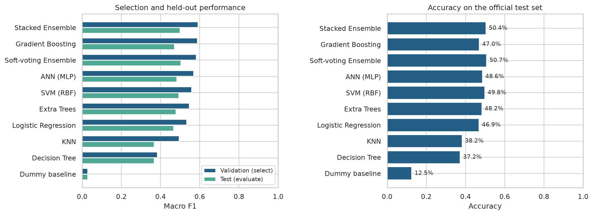

The highest observed test accuracy among all candidates is 50.75% (Soft-voting Ensemble). Test scores are descriptive: they never change the predeclared validation-based choice. Validation scores are higher than test scores for every trained model. This gap can reflect partition differences and selection on validation; these measurements alone do not establish its cause.

### 4.1 Comparison with earlier runs

The original and first-improvement reports are preserved under "baseline/" and "history/"; the original models are under "baseline/models/". All three runs use the same 800 official test tracks, so the comparison is paired.

| Run                                        | Selected model   | Test accuracy   |   Test macro F1 | Change in accuracy (pp)   | McNemar p   |
|:-------------------------------------------|:-----------------|:----------------|----------------:|:--------------------------|:------------|
| Original project (validation-only tuning)  | SVM (RBF)        | 49.12%          |          0.4885 | +1.25                     | 0.378       |
| First improvement (grouped CV, 5 families) | ANN (MLP)        | 47.25%          |          0.4695 | +3.13                     | 0.037       |
| **This optimized run**                     | Stacked Ensemble | 50.38%          |          0.4987 | —                         | —           |

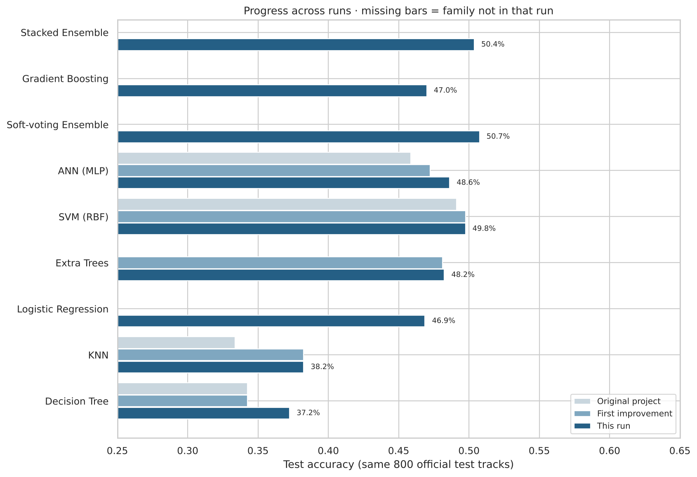

Against the original project, the McNemar p-value is 0.378 (not significant at the 5% level under the track-independence assumption). Against the first improvement, the McNemar p-value is 0.037 (below 0.05 under the track-independence assumption; this is exploratory, not artist-aware confirmation). Because the original test scores had already been seen, a fresh artist-disjoint dataset would be needed for a fully independent confirmation.

### 4.2 Cross-validation stability

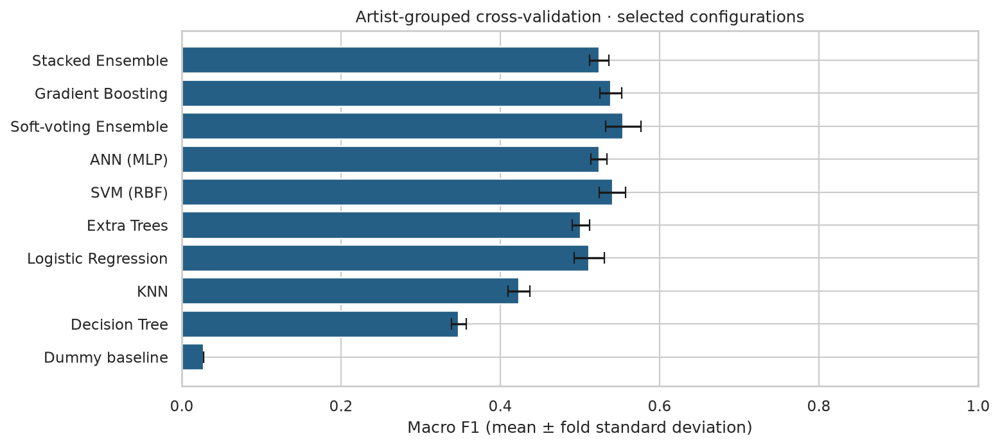

ANN seed variability (individual seeds and their probability average):

| seed     |   cv_mean_f1 |   cv_std_f1 |   validation_f1_macro |   validation_accuracy |
|:---------|-------------:|------------:|----------------------:|----------------------:|
| 42       |       0.5045 |      0.0106 |                0.5574 |                0.5625 |
| 43       |       0.5134 |      0.0036 |                0.5507 |                0.5525 |
| 44       |       0.5121 |      0.0049 |                0.5353 |                0.5387 |
| 45       |       0.5111 |      0.0108 |                0.5422 |                0.5537 |
| 46       |       0.5114 |      0.0118 |                0.5659 |                0.5725 |
| ensemble |       0.5238 |      0.0101 |                0.5688 |                0.5763 |

### 4.3 What the ensemble is made of

| Member              | Weight   |   Member CV macro F1 |
|:--------------------|:---------|---------------------:|
| SVM (RBF)           | 29%      |               0.5410 |
| ANN (MLP)           | 24%      |               0.5238 |
| Extra Trees         | 19%      |               0.5009 |
| Gradient Boosting   | 19%      |               0.5387 |
| KNN                 | 5%       |               0.4233 |
| Logistic Regression | 5%       |               0.5115 |

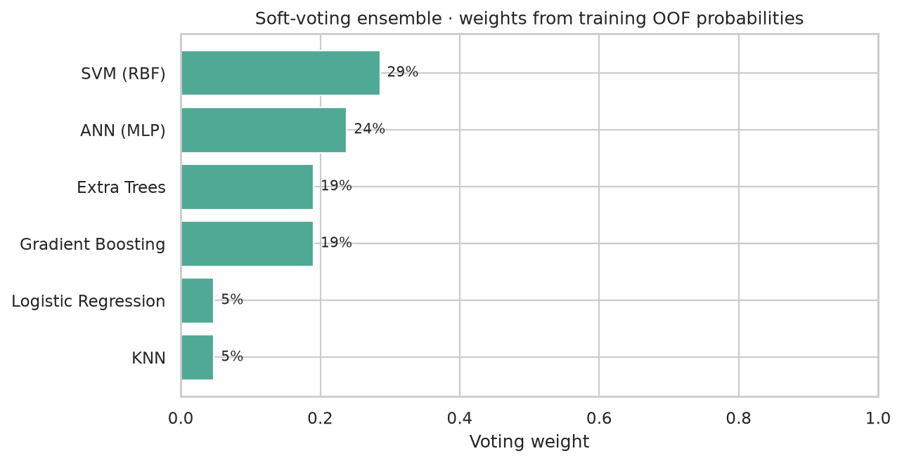

### 4.4 Per-genre performance

| Genre         |   Precision |   Recall |     F1 |   Test tracks |
|:--------------|------------:|---------:|-------:|--------------:|
| Electronic    |      0.5596 |   0.6100 | 0.5837 |           100 |
| Experimental  |      0.3333 |   0.2900 | 0.3102 |           100 |
| Folk          |      0.2439 |   0.2000 | 0.2198 |           100 |
| Hip-Hop       |      0.6981 |   0.7400 | 0.7184 |           100 |
| Instrumental  |      0.4793 |   0.5800 | 0.5249 |           100 |
| International |      0.5941 |   0.6000 | 0.5970 |           100 |
| Pop           |      0.3962 |   0.4200 | 0.4078 |           100 |
| Rock          |      0.6705 |   0.5900 | 0.6277 |           100 |

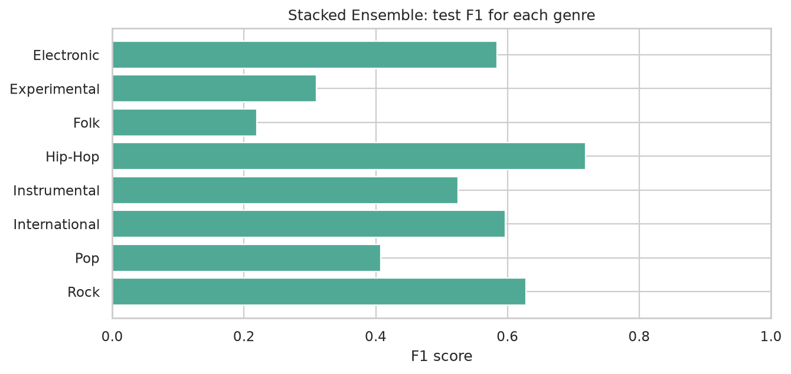

The largest off-diagonal confusion counts for the champion are:

| Actual genre   | Predicted genre   |   Tracks |
|:---------------|:------------------|---------:|
| Experimental   | Instrumental      |       27 |
| Pop            | Electronic        |       22 |
| Folk           | International     |       20 |
| International  | Folk              |       19 |
| Instrumental   | Folk              |       19 |

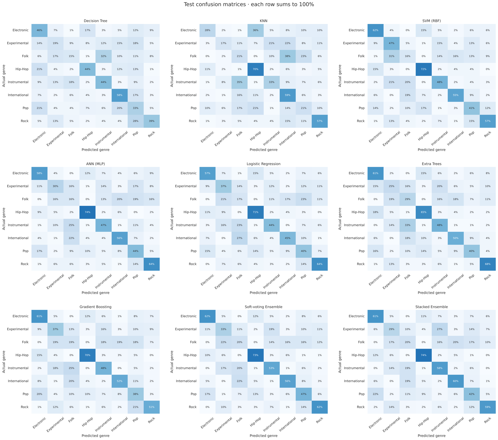

Each confusion-matrix row is normalized by the number of tracks of that actual genre. The champion recognizes Hip-Hop (F1 0.72), Rock (F1 0.63), International (F1 0.60) best and finds Experimental (F1 0.31) and Folk (F1 0.22) hardest. Experimental music is defined by breaking conventions; Experimental tracks are most often predicted as Instrumental or Pop. Folk tracks are most often predicted as International or Pop. Overlapping acoustic styles are a plausible explanation, not a proven cause.

### 4.5 How far can the predictions be trusted?

The champion outputs a probability for each genre. When its top probability is at least 60% (true for 34% of test tracks) it is correct 72.6% of the time; below 60% it is correct only 38.8% of the time. This is a descriptive association on this benchmark, not a probability-calibration study or a guarantee for an individual song.

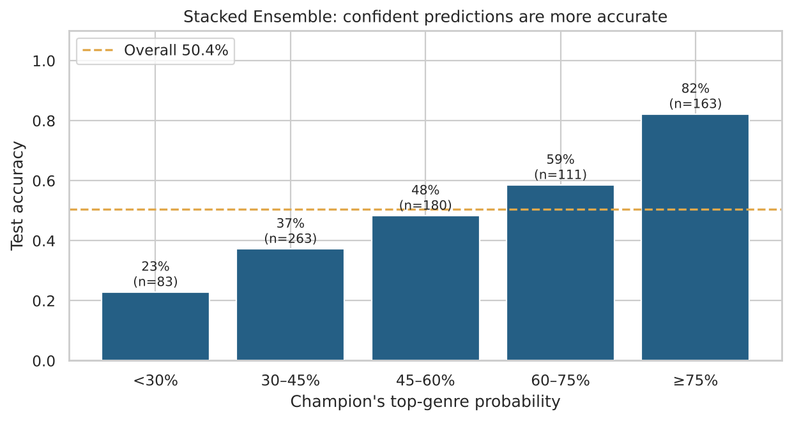

### 4.6 Computation and reproducibility

| Model                |   CV fitting (s) |   Final refit (s) |   Test prediction (s) |
|:---------------------|-----------------:|------------------:|----------------------:|
| Stacked Ensemble     |              0.0 |             260.7 |                   2.0 |
| Gradient Boosting    |            607.1 |              60.9 |                   0.3 |
| Soft-voting Ensemble |              0.0 |             257.4 |                   2.0 |
| ANN (MLP)            |            145.9 |              86.9 |                   0.3 |
| SVM (RBF)            |            116.7 |              27.4 |                   1.0 |
| Extra Trees          |            295.9 |              77.5 |                   0.2 |
| Logistic Regression  |             38.2 |               4.3 |                   0.2 |
| KNN                  |             20.0 |               0.3 |                   0.0 |
| Decision Tree        |             35.9 |               3.3 |                   0.0 |
| Dummy baseline       |              0.5 |               0.4 |                   0.0 |

The tuning, refit and evaluation stage took 19.9 minutes using 2 parallel worker processes (seed 42), with Python 3.13.18 and scikit-learn 1.8.0. Times exclude data preparation, discovery and report generation and vary by machine. Exact dependency versions and checksums are recorded in "run_info.json".

## 5. Feature interpretation

The training-only champion is evaluated on validation tracks while one entire feature family is jointly shuffled across tracks; all other families stay intact. The resulting drop in macro F1 measures how much the model relies on that family. Each family is shuffled 5 times.

| Family             |   Columns |   Mean F1 drop |   Repeat SD |
|:-------------------|----------:|---------------:|------------:|
| mfcc               |       140 |         0.2591 |      0.0072 |
| spectral_contrast  |        49 |         0.1397 |      0.0171 |
| chroma_stft        |        84 |         0.0426 |      0.0087 |
| tonnetz            |        42 |         0.0370 |      0.0086 |
| chroma_cqt         |        84 |         0.0369 |      0.0082 |
| rmse               |         7 |         0.0134 |      0.0021 |
| chroma_cens        |        84 |         0.0112 |      0.0097 |
| spectral_centroid  |         7 |         0.0029 |      0.0013 |
| zcr                |         7 |         0.0026 |      0.0029 |
| spectral_bandwidth |         7 |         0.0021 |      0.0072 |
| spectral_rolloff   |         7 |        -0.0006 |      0.0069 |

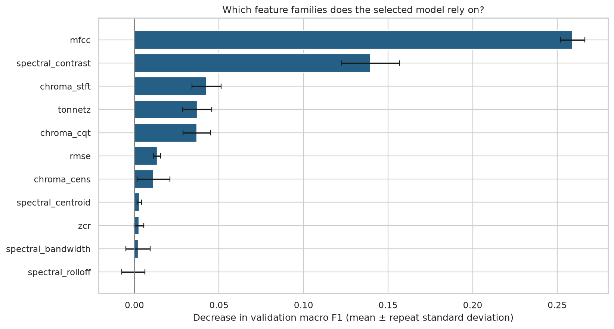

The leading families are mfcc, spectral_contrast, chroma_stft. MFCCs describe timbre (the "colour" of the sound: distorted guitars, synthesizers, voice), and spectral contrast captures the difference between spectral peaks and valleys, which can describe differences between clean acoustic recordings and denser production, without establishing a universal genre rule. Family sizes differ and correlated families can substitute for one another, so this ranking describes model reliance, not musical causation.

The ten individual descriptors most associated with genre on the training set (one-way ANOVA F):

| Descriptor                    |   Training ANOVA F |
|:------------------------------|-------------------:|
| mfcc__mean__01                |              307.0 |
| mfcc__median__01              |              305.9 |
| spectral_contrast__median__02 |              269.1 |
| spectral_contrast__mean__02   |              265.7 |
| mfcc__mean__03                |              257.0 |
| spectral_contrast__mean__04   |              253.6 |
| spectral_contrast__median__04 |              251.7 |
| mfcc__median__03              |              250.9 |
| spectral_rolloff__mean__01    |              249.5 |
| spectral_contrast__median__03 |              248.6 |

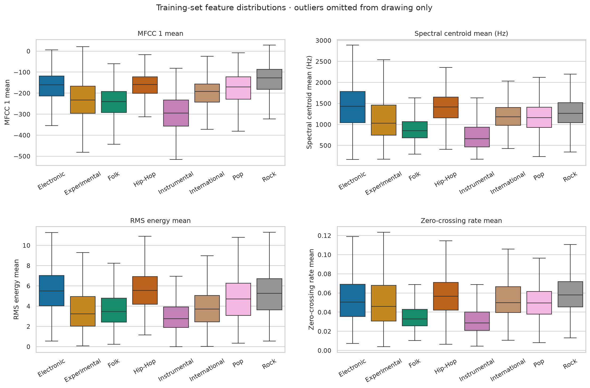

## 6. Pattern discovery and song similarity

### 6.1 PCA music map

Scaling and PCA are fitted on training descriptors only; training and validation tracks are projected into that space, and genre labels are used only as colours. The first two components keep 18.9% of the standardized variance and the first 50 keep 71.6%.

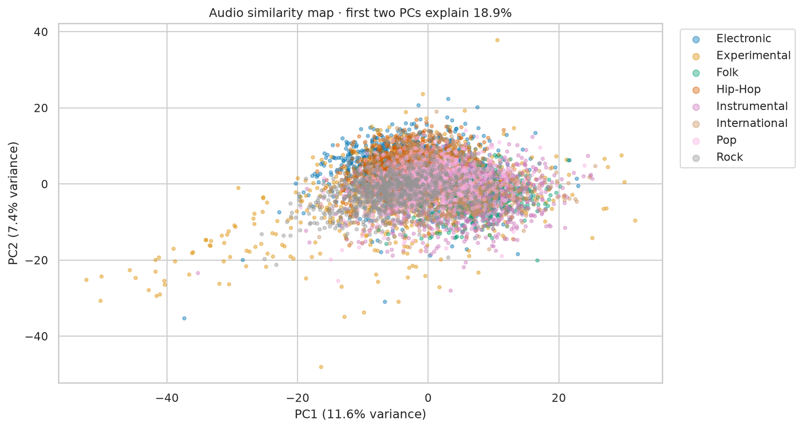

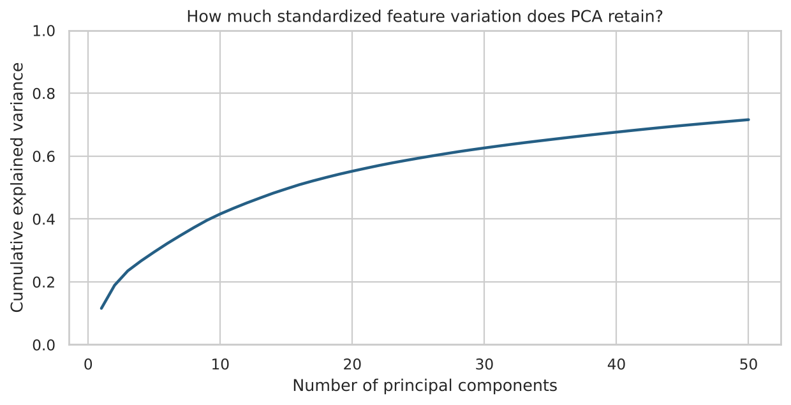

Open "song_map.html" for the offline interactive version: hover for track details, filter genres through the legend and zoom. Overlap in two dimensions is expected because most information lives in the remaining components.

### 6.2 K-means clustering

K-means (k = 8, fixed in advance) is fitted on the training PCA representation without labels; validation tracks are assigned to the nearest centroid.

- Adjusted Rand index against genres: 0.1421
- Normalized mutual information: 0.2263
- Silhouette score: 0.0320

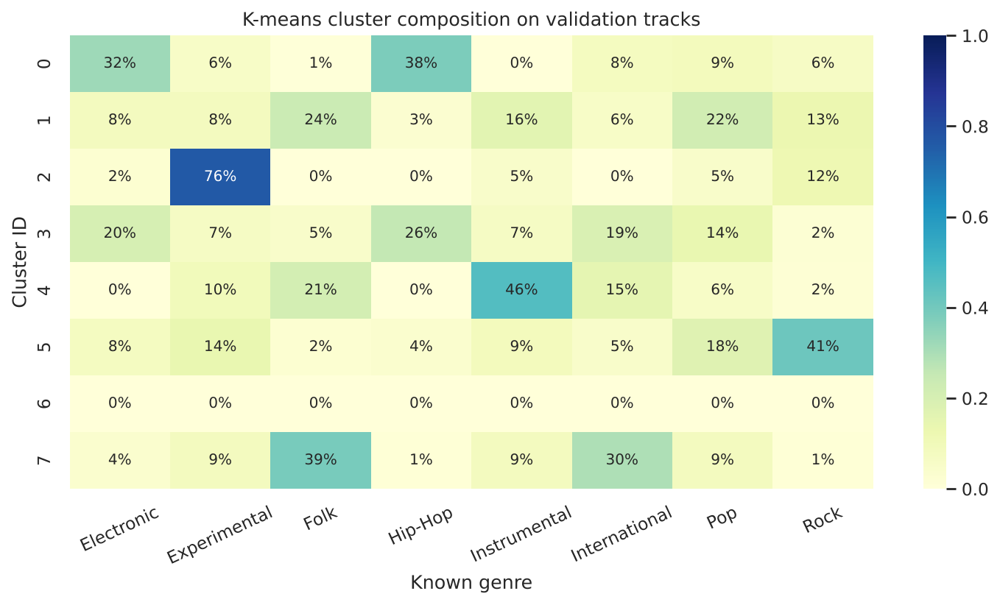

The low but positive agreement shows that these unsupervised audio clusters capture some genre structure but do not cleanly recover the genre labels. These metrics do not identify which acoustic properties cause the clusters or establish that only supervised methods can recognize genres.

### 6.3 Nearest songs

Euclidean distance in the training-fitted 50-dimensional PCA space retrieves similar training tracks. The query itself and tracks by the same artist are excluded. For validation track 148, "Blackout 2" by Contradiction (Experimental), the five nearest tracks are:

|   track_id | title                              | artist              | genre      |   distance |
|-----------:|:-----------------------------------|:--------------------|:-----------|-----------:|
|      12537 | Maree Lunaire                      | Smoking After       | Pop        |    14.8493 |
|     127297 | The Pursuit of Unintentional Humor | Oh Yeah, the Future | Pop        |    15.1498 |
|     145730 | STOCKPILE! (Funky Dubb Mixx)       | LOWdown             | Hip-Hop    |    15.1676 |
|     113972 | Your Pulse                         | Little Glass Men    | Electronic |    15.2270 |
|      98838 | intense                            | Moonove             | Electronic |    15.5530 |

Distances are representation-specific and not listener-preference scores; this is an audio-similarity demonstration, not a personalized recommender.

## 7. Discussion and limitations

1. **Representation limits.** All models use the same 518 summary statistics, which discard the order of musical events. Representation is a possible bottleneck, but this finite model search does not establish a feature ceiling; spectrograms or pretrained audio embeddings are alternatives to evaluate.
2. **Overlapping labels.** Each track carries one top-level genre although many songs mix styles. Top-3 accuracy shows how often the correct label remains among three guesses; it does not by itself prove perceptual similarity between confused genres.
3. **Reused test set.** The official test partition was viewed in the original project, so improvements are an extended benchmark comparison. The track-level McNemar test and bootstrap intervals do not remove this limitation and do not account for within-artist dependence.
4. **Finite search.** Grids are deliberately affordable on a laptop. Larger searches could find slightly better settings for individual families.
5. **Artist effects.** Artist-disjoint splits remove artist memorization but not every production or label-specific correlation.
6. **Importance is not causation.** Permutation importance describes one fitted model on one validation set.
7. **New audio.** Predicting a new MP3 requires extracting the same descriptors; "musicmap extract" follows the official FMA extraction recipe, but modern library versions can produce slightly different values.

## 8. Conclusion and future work

Using training-fitted preprocessing and artist-disjoint outer evaluation, Stacked Ensemble was selected on validation and obtained 50.38% test accuracy and 0.4987 macro F1 on eight balanced genres — about 4.0 times the chance level. The strongest individual families on validation were Gradient Boosting, ANN (MLP), SVM (RBF). The stacked ensemble differs from the best single validation family (Gradient Boosting) by +3.38 accuracy points on test and +0.0041 macro F1 on validation. The feature analysis highlights mfcc, spectral_contrast, chroma_stft, while the unsupervised clusters only partially agree with genre labels.

Future work: learn directly from mel-spectrograms with a CNN or use pretrained audio embeddings (e.g. VGGish, PANNs, CLAP), extend to the 16-genre FMA-medium subset, and confirm results on a fresh artist-disjoint test set.

## 9. Reproduction and deliverables

~~~sh
python -m pip install -r requirements.txt "scikit-learn==1.8.0"
musicmap improve --seed 42
musicmap predict --track-id 704
musicmap neighbors --track-id 704 --k 5
python -m pytest -q --junitxml=/tmp/musicmap-tests.xml
python scripts/verify_artifacts.py --test-report /tmp/musicmap-tests.xml
jupyter lab notebooks/MusicMap.ipynb
~~~

The notebook displays the included results by default; set RUN_TRAINING = True to recompute. "musicmap app" starts an interactive demo in the browser. The examples use held-out test track 704; demonstration examples are not a new evaluation. The included saved classifiers require scikit-learn 1.8.0. Own-audio extraction requires a sample rate of at least 11,025 Hz; lower-rate files receive conversion guidance rather than being silently resampled. FFmpeg and ffprobe enable decoding of M4A/AAC files unsupported by the default decoder. No GPU or benchmark audio download is needed.

## References and attribution

1. Defferrard, M., Benzi, K., Vandergheynst, P., and Bresson, X. (2017). FMA: A Dataset for Music Analysis. ISMIR. https://arxiv.org/abs/1612.01840
2. Official FMA repository: https://github.com/mdeff/fma
3. Caruana, R., Niculescu-Mizil, A., Crew, G., and Ksikes, A. (2004). Ensemble selection from libraries of models. ICML.
4. Pedregosa, F. et al. (2011). Scikit-learn: Machine Learning in Python. JMLR 12, 2825–2830. https://scikit-learn.org/
5. McNemar, Q. (1947). Note on the sampling error of the difference between correlated proportions or percentages. Psychometrika 12, 153–157.

FMA metadata and derived features are attributed to Defferrard et al. and distributed under CC BY 4.0. No audio is redistributed.
