# MusicMap
## Music Genre Classification and Pattern Discovery Using Machine Learning

ML Laboratory Project

Student: [Enter your name]  
Roll number: [Enter your roll number]  
Department / institution: [Enter details]  
Course / instructor: [Enter details]

## Abstract

MusicMap investigates whether precomputed audio descriptors can distinguish music genres and reveal relationships between songs. The experiment uses 8,000 tracks from the balanced FMA-small subset, with eight genres and 518 numeric features. Decision Tree, K-nearest neighbors (KNN), radial-basis-function support vector machine (SVM), and a feed-forward artificial neural network (ANN) are compared with Extra Trees and a majority-class baseline. The official artist-disjoint training, validation, and test partitions are preserved. Hyperparameters are tuned using artist-grouped cross-validation within training, and the winning family is chosen using validation macro F1 before an extended comparison on the previously viewed official test set. The selected model, ANN (MLP), achieves 47.25% test accuracy and 0.4695 test macro F1 in this run. PCA, K-means, nearest-neighbor retrieval, and grouped permutation importance provide complementary views of musical similarity and feature relevance. The findings describe this dataset and experimental configuration rather than universal genre boundaries.

## 1. Problem statement and objectives

Genre labels can help organize large music collections, but genres share instruments, production styles, and musical conventions. The project treats genre recognition as supervised multiclass classification: one feature vector is mapped to one of eight top-level genre labels.

The objectives are:

1. Prepare a manageable, reproducible dataset using audio features rather than downloading or decoding thousands of recordings.
2. Compare Decision Tree, KNN, SVM, ANN, and Extra Trees on identical external partitions and report more than accuracy alone.
3. Identify audio feature families associated with genre separation.
4. Discover similarities through dimensionality reduction, clustering, and nearest-neighbor retrieval.

The research questions are which model performs best under this protocol, which genres it confuses, and whether audio-based clusters agree with the supplied labels.

## 2. Dataset and features

The source is FMA: A Dataset for Music Analysis by Defferrard, Benzi, Vandergheynst, and Bresson (ISMIR 2017). FMA-small contains 8,000 30-second track excerpts, balanced across Electronic, Experimental, Folk, Hip-Hop, Instrumental, International, Pop, and Rock. This project retains 8,000 tracks.

Only the official 342 MiB metadata archive is required. The 7.2 GiB FMA-small audio archive is unnecessary for these experiments. The published archive SHA-1 is verified as f0df49ffe5f2a6008d7dc83c6915b31835dfe733. The CSVs have multiple header rows; feature rows and metadata are joined by track ID, never by assumed row position.

| Partition   |   Tracks | Role                                   |
|:------------|---------:|:---------------------------------------|
| training    |     6400 | Fit candidate models and preprocessing |
| validation  |      800 | Choose hyperparameters and model       |
| test        |      800 | Final held-out evaluation              |

Each genre contributes 800 training, 100 validation, and 100 test tracks. The recorded overlap counts for artist IDs are {'training__validation': 0, 'training__test': 0, 'validation__test': 0}; missing artist IDs: 0. Thus this prepared release has no artists shared across partitions.

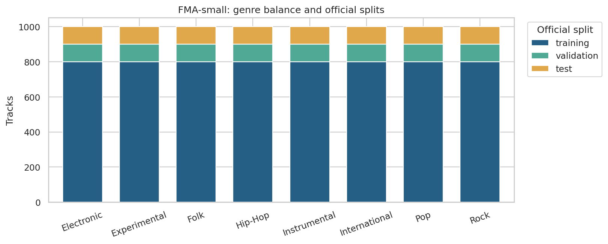

The 518 descriptors belong to 11 audio feature families. For each feature dimension, the dataset provides mean, standard deviation, skewness, kurtosis, median, minimum, and maximum over analysis frames. Predictors contain audio descriptors only. Titles, track IDs, artist IDs, album IDs, genre labels, and split labels are kept separately and never enter classifiers.

| Family             |   Columns | Meaning                                                           |
|:-------------------|----------:|:------------------------------------------------------------------|
| chroma_cens        |        84 | Smoothed pitch-class energy; harmonic content                     |
| chroma_cqt         |        84 | Constant-Q pitch-class energy; harmonic content                   |
| chroma_stft        |        84 | STFT pitch-class energy; harmonic content                         |
| mfcc               |       140 | Mel-frequency cepstral coefficients; timbre and spectral envelope |
| rmse               |         7 | Root mean square energy; signal energy                            |
| spectral_bandwidth |         7 | Spread of spectral energy around its centroid                     |
| spectral_centroid  |         7 | Centre of spectral energy; brightness                             |
| spectral_contrast  |        49 | Peak-to-valley differences in spectral bands                      |
| spectral_rolloff   |         7 | Frequency below which most spectral energy lies                   |
| tonnetz            |        42 | Tonal centroid coordinates; harmonic relationships                |
| zcr                |         7 | Zero-crossing rate; noisiness and rapid signal changes            |

For example, "mfcc__mean__01" means the temporal mean of the first MFCC coefficient. The table has no explicit tempo/BPM feature; this project does not claim to measure tempo directly.

Data-quality checks found 0 non-finite feature values, 0 tracks requiring partial imputation, and 0 completely missing feature rows. Stored features use float32 to reduce memory. Prepared files also have SHA-256 integrity checks.

## 3. Experimental methodology

### 3.1 Preprocessing and candidate representations

The official 6,400-track training partition is the only source of cross-validation data. Every fitted pipeline learns median imputation, constant-column removal, scaling, and any feature reduction from the current fitting fold. Fold-assessment features and labels are not used to fit those transformations.

The improved experiment compares the full descriptor representation with training-fitted feature selection and PCA. ANOVA selection ranks individual descriptors by their association with the training labels; PCA learns directions of high transformed-feature variance without labels. The candidate search also compares standard scaling with a quantile-to-normal transformation to handle skewed feature distributions and extreme values. These transformations are fitted within each fold. This supervised candidate search is separate from the fixed standardized 50-component PCA representation used for the similarity map and clustering.

Training-only diagnostics found 83 descriptors with an absolute standardized value above 20, with maximum absolute z-score 79.96. These observations motivated testing quantile normalization. A quantile transform changes distances and can discard useful scale information; it is not universally beneficial. Its settings are chosen using training CV, and this diagnostic does not use validation or test rows.

### 3.2 Artist-grouped cross-validation and selection

The search evaluates 94 recorded configurations with 3-fold artist-grouped cross-validation inside the official training partition. The fold builder preserves artist groups: no artist occurs in both fitting and assessment tracks in a fold. "cv_splits.json" records the assignments and audits. Each candidate's mean macro F1 across these folds is the tuning criterion; its standard deviation describes fold-to-fold variability, not a confidence interval.

For each model family, the configuration with the highest mean cross-validation macro F1 advances to the official 800-track validation partition. The final winning family is chosen using validation macro F1, with the recorded tie-breaking rules in "selection.json". Validation is outside the cross-validation folds. The official test set contributes no features or labels to this run's search or selection.

The improved search broadens SVM regularization/kernel settings, compares feature representations, tunes ANN size/learning rate/regularization, and adds Extra Trees as an ensemble benchmark. The four original required algorithms remain present. "cv_results.csv" contains all candidate settings and scores; the following summarizes the best cross-validation row per family:

| model          |   cv_mean_f1 |   cv_std_f1 | parameters                                                                                                                                                                     |
|:---------------|-------------:|------------:|:-------------------------------------------------------------------------------------------------------------------------------------------------------------------------------|
| SVM (RBF)      |       0.5410 |      0.0166 | {"scaling": "quantile", "reduction": "select", "classifier": {"C": 1.0, "gamma": "scale"}, "n_components": 256}                                                                |
| Extra Trees    |       0.5038 |      0.0091 | {"scaling": "standard", "reduction": "all", "classifier": {"n_estimators": 300, "max_features": 0.5, "min_samples_leaf": 2}}                                                   |
| ANN (MLP)      |       0.5024 |      0.0078 | {"scaling": "quantile", "reduction": "all", "classifier": {"hidden_layer_sizes": [128], "learning_rate_init": 0.0003, "alpha": 0.01, "max_iter": 300, "n_iter_no_change": 20}} |
| KNN            |       0.4233 |      0.0138 | {"scaling": "standard", "reduction": "select", "classifier": {"n_neighbors": 15, "weights": "distance"}, "n_components": 128}                                                  |
| Decision Tree  |       0.3368 |      0.0119 | {"scaling": "standard", "reduction": "all", "classifier": {"max_depth": 10, "min_samples_leaf": 5}}                                                                            |
| Dummy baseline |       0.0277 |      0.0000 | {"scaling": "standard", "reduction": "all", "classifier": {}}                                                                                                                  |

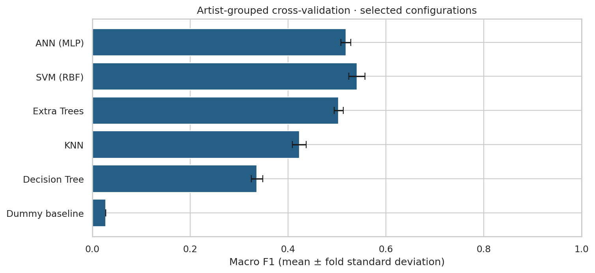

The CV chart uses the selected family configurations and displays fold standard deviations. For ANN, it shows the fixed three-seed ensemble's CV score; the table above shows the base-seed architecture search.

The ANN is a feed-forward network operating on descriptors. The architecture, learning rate, and regularization grid is tuned using base seed 42, with at most 300 epochs and early-stopping patience of 20 epochs. Its selected configuration is evaluated with seeds 42, 43, 44, and the final ANN uses a fixed average of all three models' class probabilities. No best-performing seed is cherry-picked. The individual and ensemble scores are retained in "ann_seed_results.csv"; the base-seed tuning scores and final ensemble CV score answer different questions. The numeric label encoder converts predictions back to readable genres. Each network uses an internal random 10% track holdout for early stopping, within its current fitting partition; that internal split is distinct from the artist-disjoint outer folds and official validation/test partitions.

| seed     |   cv_mean_f1 |   cv_std_f1 |   validation_f1_macro |   validation_accuracy |
|:---------|-------------:|------------:|----------------------:|----------------------:|
| 42       |       0.5024 |      0.0078 |                0.5252 |                0.5288 |
| 43       |       0.4954 |      0.0142 |                0.5395 |                0.5487 |
| 44       |       0.4920 |      0.0112 |                0.5358 |                0.5375 |
| ensemble |       0.5184 |      0.0101 |                0.5613 |                0.5663 |

Selected settings for each family:

| Model          | Settings                                                                                                                                                                       |
|:---------------|:-------------------------------------------------------------------------------------------------------------------------------------------------------------------------------|
| Decision Tree  | {"scaling": "standard", "reduction": "all", "classifier": {"max_depth": 10, "min_samples_leaf": 5}}                                                                            |
| KNN            | {"scaling": "standard", "reduction": "select", "classifier": {"n_neighbors": 15, "weights": "distance"}, "n_components": 128}                                                  |
| SVM (RBF)      | {"scaling": "quantile", "reduction": "select", "classifier": {"C": 1.0, "gamma": "scale"}, "n_components": 256}                                                                |
| ANN (MLP)      | {"scaling": "quantile", "reduction": "all", "classifier": {"hidden_layer_sizes": [128], "learning_rate_init": 0.0003, "alpha": 0.01, "max_iter": 300, "n_iter_no_change": 20}} |
| Extra Trees    | {"scaling": "standard", "reduction": "all", "classifier": {"n_estimators": 300, "max_features": 0.5, "min_samples_leaf": 2}}                                                   |
| Dummy baseline | {"scaling": "standard", "reduction": "all", "classifier": {}}                                                                                                                  |

### 3.3 Refit and extended test comparison

The complete selection is saved before this run requests test features or labels. Selected configurations are freshly fitted on the combined 7,200 training and validation tracks. Their predictions on the 800 official test tracks are recorded once for this run. The dummy model is a contextual baseline and cannot win the trained-model selection.

The same official test set was already viewed in the original experiment. The updated scores therefore provide an extended benchmark comparison, not a pristine new confirmatory holdout. Decisions in the implemented search use training folds and validation scores; a fresh artist-disjoint confirmation set would strengthen claims about generalization gains.

### 3.4 Algorithms and evaluation

- Decision Tree learns threshold rules that reduce class impurity.
- KNN uses neighboring transformed feature representations and inverse-distance votes.
- RBF SVM learns a nonlinear separating boundary; C and gamma control regularization and kernel locality.
- ANN learns nonlinear combinations of descriptors using fully connected layers and regularization.
- Extra Trees averages randomized decision trees to reduce sensitivity to a single fitted tree.

Accuracy is correct labels divided by track count. Per-genre precision is TP / (TP + FP), recall is TP / (TP + FN), and F1 is their harmonic mean. Macro F1 gives all eight genres equal weight. Undefined scores are assigned zero. With balanced test genres, balanced accuracy equals accuracy.

Cross-validation scores describe fold-fitted candidates. Validation scores describe training-partition fits, and test scores describe models refitted on training plus validation. They concern different fitted models and different samples.

## 4. Results

The algorithm selected before test evaluation is **ANN (MLP)**. Its test accuracy is **47.25%** and macro F1 is **0.4695**. The dummy baseline reaches 12.50% accuracy and 0.0278 macro F1.

| Model          |   Validation F1 | Test accuracy   |   Test precision |   Test recall |   Test F1 |
|:---------------|----------------:|:----------------|-----------------:|--------------:|----------:|
| ANN (MLP)      |          0.5613 | 47.25%          |           0.4698 |        0.4725 |    0.4695 |
| SVM (RBF)      |          0.5575 | 49.75%          |           0.4916 |        0.4975 |    0.4925 |
| Extra Trees    |          0.5430 | 48.12%          |           0.4754 |        0.4813 |    0.4760 |
| KNN            |          0.4944 | 38.25%          |           0.3887 |        0.3825 |    0.3674 |
| Decision Tree  |          0.3656 | 34.25%          |           0.3488 |        0.3425 |    0.3437 |
| Dummy baseline |          0.0278 | 12.50%          |           0.0156 |        0.1250 |    0.0278 |

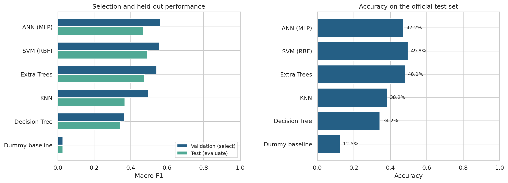

The model ordering follows validation macro F1. A higher test score from another model would be a descriptive observation, not a reason to change the preselected winner. These are actual measurements from the included run; scores from a different machine or dependency version may differ slightly.

### 4.1 Comparison with the preserved original run

| Run                       | Selected model   |   Validation macro F1 |   Test accuracy |   Test macro F1 |
|:--------------------------|:-----------------|----------------------:|----------------:|----------------:|
| Original standard profile | SVM (RBF)        |                0.5464 |          0.4913 |          0.4885 |
| Improved experiment       | ANN (MLP)        |                0.5613 |          0.4725 |          0.4695 |

The selected model's test accuracy changes by -1.88 percentage points, and macro F1 changes by -0.0190. The original reports, predictions, and models are preserved under baseline/. This is an extended benchmark comparison: the official test performance was already seen during the original project. It is not an independent, newly unseen confirmation of the improvement. A fresh artist-disjoint dataset would provide stronger confirmation.

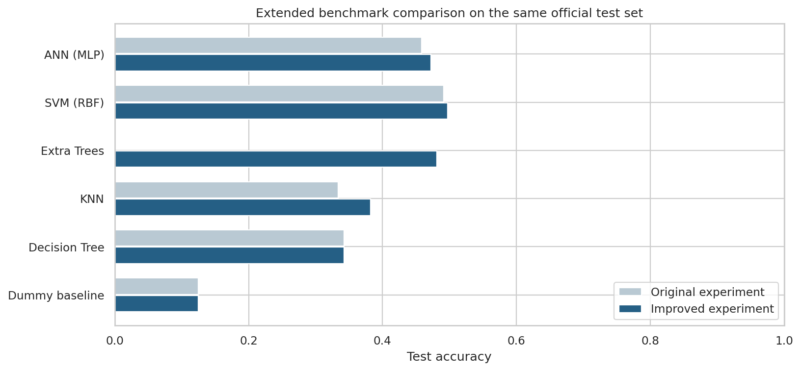

Same-family comparisons:

| Model          | Original test accuracy   | Updated test accuracy   | Change (percentage points)   |   Updated test macro F1 |
|:---------------|:-------------------------|:------------------------|:-----------------------------|------------------------:|
| ANN (MLP)      | 45.88%                   | 47.25%                  | +1.375                       |                  0.4695 |
| SVM (RBF)      | 49.12%                   | 49.75%                  | +0.625                       |                  0.4925 |
| Extra Trees    | New benchmark            | 48.12%                  | —                            |                  0.4760 |
| KNN            | 33.38%                   | 38.25%                  | +4.875                       |                  0.3674 |
| Decision Tree  | 34.25%                   | 34.25%                  | +0.000                       |                  0.3437 |
| Dummy baseline | 12.50%                   | 12.50%                  | +0.000                       |                  0.0278 |

The validation-selected model is ANN (MLP); the highest observed updated test accuracy is 49.75% from SVM (RBF). Test performance is descriptive and does not change the predeclared validation-based selection. Broader tuning improves some same-family scores in this run, but it does not establish a general improvement of the selection procedure. Small differences on 800 tracks do not by themselves demonstrate statistically significant gains.

### 4.2 Per-genre performance

| Genre         |   Precision |   Recall |     F1 |   Test tracks |
|:--------------|------------:|---------:|-------:|--------------:|
| Electronic    |      0.5816 |   0.5700 | 0.5758 |           100 |
| Experimental  |      0.3303 |   0.3600 | 0.3445 |           100 |
| Folk          |      0.1705 |   0.1500 | 0.1596 |           100 |
| Hip-Hop       |      0.6207 |   0.7200 | 0.6667 |           100 |
| Instrumental  |      0.4875 |   0.3900 | 0.4333 |           100 |
| International |      0.5851 |   0.5500 | 0.5670 |           100 |
| Pop           |      0.3966 |   0.4600 | 0.4259 |           100 |
| Rock          |      0.5859 |   0.5800 | 0.5829 |           100 |

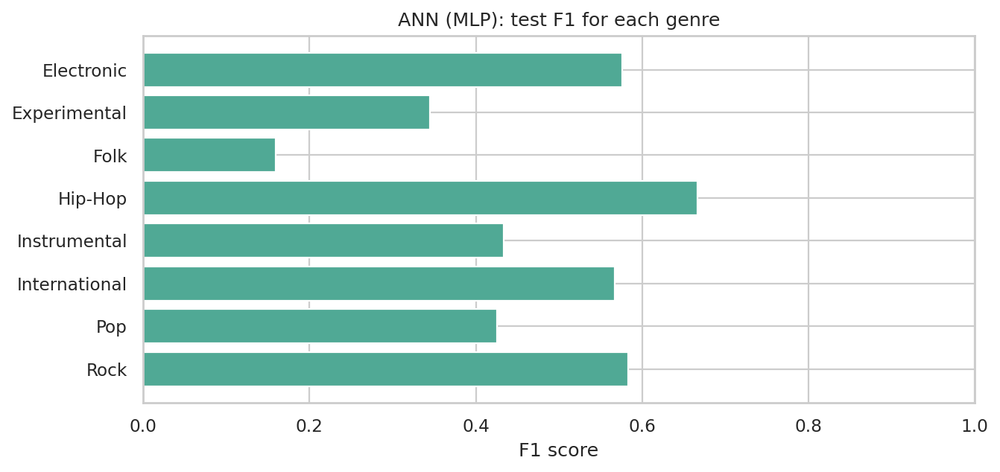

The largest off-diagonal confusion counts for the selected model are:

| Actual genre   | Predicted genre   |   Tracks |
|:---------------|:------------------|---------:|
| Folk           | Experimental      |       30 |
| International  | Folk              |       23 |
| Instrumental   | Folk              |       22 |
| Experimental   | Folk              |       19 |
| Electronic     | Hip-Hop           |       18 |

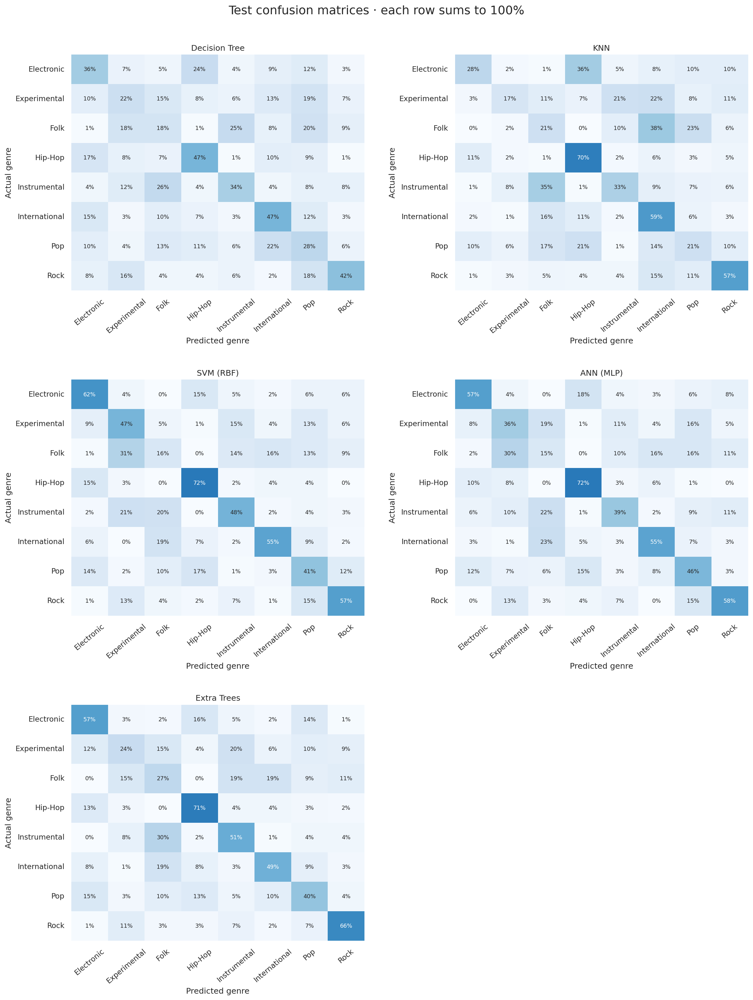

Each confusion-matrix row is normalized by its actual genre count. These errors show overlap in the supplied acoustic representation; they do not prove that a genre label is wrong.

### 4.3 Computation and reproducibility

| Model          |   Candidate fitting (s) |   Final refit (s) |   Test prediction (s) |
|:---------------|------------------------:|------------------:|----------------------:|
| ANN (MLP)      |                 81.2847 |           10.1862 |                0.1591 |
| SVM (RBF)      |                303.7297 |            4.4451 |                0.7739 |
| Extra Trees    |                269.1126 |           70.3862 |                0.0991 |
| KNN            |                  7.1807 |            0.3498 |                0.0392 |
| Decision Tree  |                 40.8646 |            3.9737 |                0.0070 |
| Dummy baseline |                  0.2330 |            0.3395 |                0.0068 |

The full tuning/refitting/evaluation stage took 1182.5 seconds in the execution environment, using a limit of 2 numerical-library threads and seed 42. Times exclude downloading, preparation, visualization, and report generation. Candidate fitting time sums primary candidate cross-validation fits only. It excludes the additional ANN seed diagnostics and full-training fits; those stages, predictions, and overhead are included in the total elapsed time. This timing is not a laptop performance guarantee.

The run used Python 3.12.14 and scikit-learn 1.8.0. Exact direct dependency versions are recorded in "requirements-tested.txt"; runtime details are in "run_info.json". A fixed seed improves repeatability but does not establish robustness across random seeds.

Fitting diagnostics:

No fitting warnings were recorded.

## 5. Feature interpretation

The selected training-only model is evaluated on validation tracks. One entire feature family is jointly shuffled across tracks while all other families remain unchanged. The drop in macro F1 estimates how much this fitted model relies on that family. Joint shuffling preserves correlations among columns within the family. Each family uses 5 repeated permutations with a fixed seed.

| Family             |   Columns |   Mean F1 drop |   Repeat SD |
|:-------------------|----------:|---------------:|------------:|
| mfcc               |       140 |         0.2446 |      0.0053 |
| spectral_contrast  |        49 |         0.1617 |      0.0089 |
| chroma_cqt         |        84 |         0.0781 |      0.0090 |
| chroma_cens        |        84 |         0.0537 |      0.0081 |
| tonnetz            |        42 |         0.0489 |      0.0121 |
| chroma_stft        |        84 |         0.0471 |      0.0129 |
| rmse               |         7 |         0.0317 |      0.0115 |
| spectral_bandwidth |         7 |         0.0305 |      0.0051 |
| zcr                |         7 |         0.0198 |      0.0081 |
| spectral_rolloff   |         7 |         0.0157 |      0.0036 |
| spectral_centroid  |         7 |         0.0132 |      0.0029 |

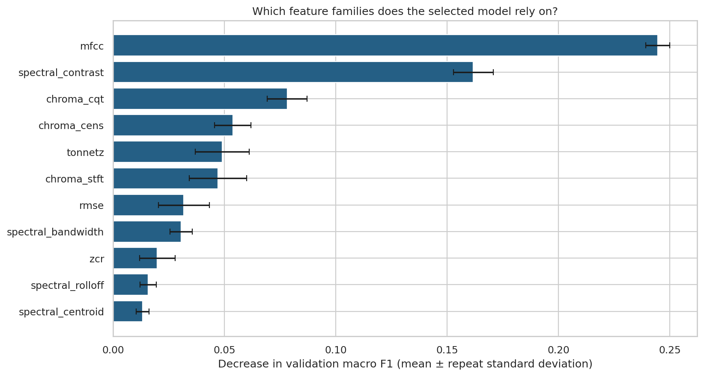

The leading families in this run are mfcc, spectral_contrast, chroma_cqt. The audio meanings of these families are listed in Section 2. Positive drops indicate reliance; near-zero or negative drops can reflect redundancy, sampling variation, or features that the model does not use effectively. The error bars show variability across permutations, not confidence intervals across new datasets. Family sizes differ, and correlated families can substitute for one another, so the ranking is neither causal nor an equal-size feature comparison.

Individual descriptors can also be ranked by a training-only one-way ANOVA F score:

| Descriptor                    |   Training ANOVA F |
|:------------------------------|-------------------:|
| mfcc__mean__01                |           306.9543 |
| mfcc__median__01              |           305.9203 |
| spectral_contrast__median__02 |           269.0754 |
| spectral_contrast__mean__02   |           265.7206 |
| mfcc__mean__03                |           256.9555 |
| spectral_contrast__mean__04   |           253.6100 |
| spectral_contrast__median__04 |           251.7100 |
| mfcc__median__03              |           250.8509 |
| spectral_rolloff__mean__01    |           249.5471 |
| spectral_contrast__median__03 |           248.5839 |

This displayed full-training ranking is an exploratory association measure. It ignores multivariate interactions and correlated predictors and is not a multiple-testing-adjusted significance claim. Any ANOVA selector in a supervised candidate is separately fitted within its own training fold; the displayed ranking is not reused across CV folds.

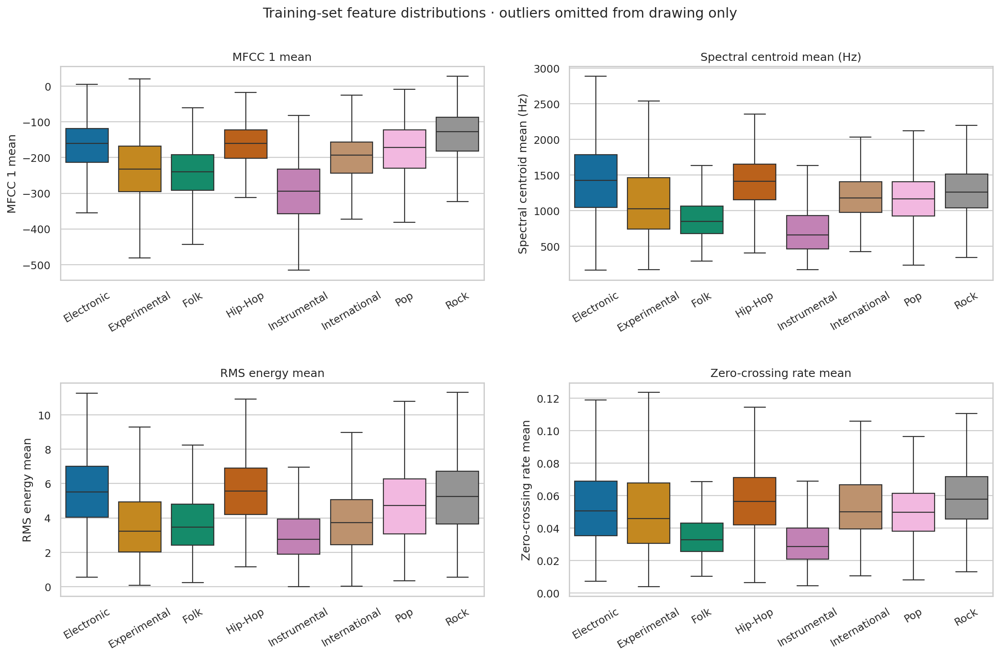

Boxes show medians and interquartile ranges. Outlier points are omitted only from the drawing; they remain in the training data. Overlapping distributions explain why no single simple descriptor is expected to identify every genre.

## 6. Pattern discovery and song similarity

### 6.1 PCA music map

Preprocessing and PCA are fitted only on training audio features. Training and validation tracks are projected into that space; genre labels are added only as display colors. The first two principal components retain 18.91% of standardized feature variance, and the first 50 retain 71.59%.

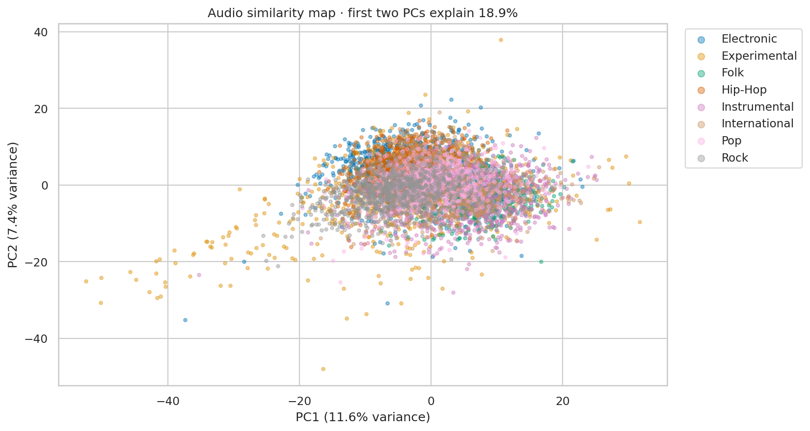

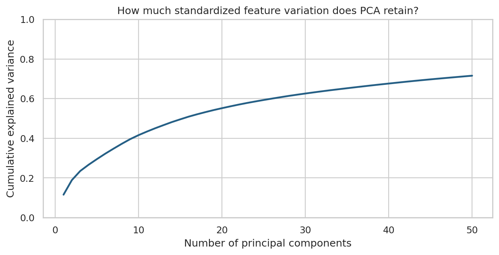

Open "song_map.html" for the offline interactive map: hover for track details, filter genres through the legend, and zoom. Nearby points share aspects of their measured audio descriptors. Since two dimensions discard information, separation or overlap in this drawing is not a classifier accuracy result.

### 6.2 K-means clustering

K-means uses the training-set 50-dimensional PCA representation and k = 8, fixed in advance to match the number of known genres. It does not use genre labels during fitting. Validation tracks receive the nearest learned cluster centroid.

- Adjusted Rand index against validation genres: 0.1403.
- Normalized mutual information against validation genres: 0.2244.
- Validation silhouette score in PCA space: 0.04055146872997284.

ARI measures agreement after accounting for chance, NMI measures shared label information, and silhouette measures geometric compactness/separation. Cluster numbers are arbitrary and cannot be interpreted as genre IDs. A cluster can contain multiple genres, and one genre can span multiple clusters.

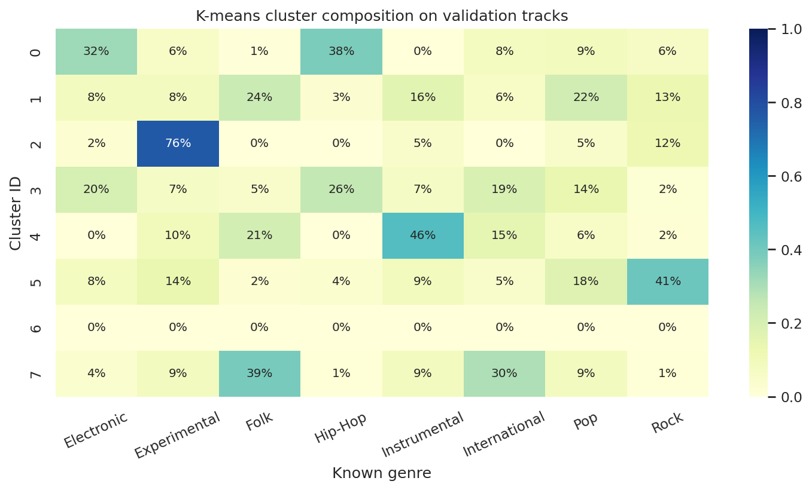

The validation metrics and composition chart are descriptive; they are not used to tune k or select a classifier. Test tracks are excluded from discovery analyses.

### 6.3 Nearest songs

Euclidean distance in the training-fitted 50-dimensional PCA space retrieves similar tracks from the training catalog. The query itself and tracks with the same artist ID are excluded by default. Genre labels are shown for interpretation and are not part of the distance.

For validation query ID 148, "Blackout 2" by Contradiction (Experimental), the five nearest eligible training tracks are:

|   track_id | title                              | artist              | genre      |   distance |
|-----------:|:-----------------------------------|:--------------------|:-----------|-----------:|
|      12537 | Maree Lunaire                      | Smoking After       | Pop        |    14.8261 |
|     127297 | The Pursuit of Unintentional Humor | Oh Yeah, the Future | Pop        |    15.1386 |
|     145730 | STOCKPILE! (Funky Dubb Mixx)       | LOWdown             | Hip-Hop    |    15.1609 |
|     113972 | Your Pulse                         | Little Glass Men    | Electronic |    15.2266 |
|      98838 | intense                            | Moonove             | Electronic |    15.5473 |

Distances are representation-specific values, not probabilities or listener-preference scores. This is an audio similarity demonstration rather than a personalized recommendation system.

## 7. Discussion and limitations

1. The five trained algorithms receive the same external partitions and artist-grouped fold assignments. The finite candidate search still does not establish the best possible performance for each model family.
2. Artist-disjoint splits reduce artist memorization. They do not remove every potential recording, production, album, or dataset-specific correlation.
3. Genre boundaries are subjective and sometimes overlapping. This task uses one top-level label per track and only eight FMA-small genres.
4. Summary descriptors discard musical sequence and detailed temporal structure. The model does not directly process waveforms or learn from spectrograms.
5. Multiple ANN initialization seeds are examined, but this limited seed set does not fully characterize optimization variability. Consult the recorded ANN settings and seed results rather than treating one fit as universal.
6. Standard scaling can remain sensitive to extreme values. PCA maximizes variance rather than genre discrimination, and the 2D map discards most dimensions.
7. Grouped permutation importance describes reliance of one tuned model on one validation set. The validation partition has already influenced model selection, so it is not an independent confirmatory interpretation dataset.
8. The official test set was already viewed before this improvement study. Updated scores are an extended benchmark comparison and require a fresh artist-disjoint confirmation set for stronger generalization claims.
9. Predicting a genuinely new audio file requires compatible extraction of the same descriptors. The delivered predictor accepts prepared FMA feature rows or a matching flat feature CSV; raw MP3 feature extraction is outside this implementation.

## 8. Conclusion and future work

MusicMap provides a reproducible comparison of Decision Tree, KNN, SVM, ANN, and Extra Trees for feature-based music genre classification. Under the recorded protocol, ANN (MLP) was selected on validation data and obtained 47.25% test accuracy with 0.4695 macro F1. The feature analysis highlights mfcc, spectral_contrast, chroma_cqt, while PCA, K-means, and nearest-neighbor retrieval reveal relationships that are only partly aligned with genre labels.

Artist-grouped cross-validation, feature reduction, multiple ANN seeds, and an ensemble benchmark are now implemented. Further work can use more genres, pretrained audio embeddings, and a fresh artist-disjoint confirmation set. Future decisions should use development data rather than the reported test scores.

## 9. Reproduction and deliverables

From the project directory, install the requirements and run:

~~~sh
python -m pip install -r requirements-tested.txt
musicmap improve --seed 42 --threads 2 --cv-folds 3
jupyter lab notebooks/MusicMap.ipynb
~~~

The notebook defaults to displaying the included results. Set its RUN_TRAINING and RUN_DISCOVERY switches to True to recompute. Prepared subset data are bundled in the complete package; if absent, preparation downloads the official metadata archive automatically. No audio download or GPU is required.

Deliverables include the Python package, executed notebook, metric tables, all test predictions, selected model, interactive map, figures, this report in Markdown/HTML/Word, a presentation outline, and viva preparation notes. Fill in the student and institution fields and adapt the report to the instructor's required format.

## References and attribution

1. Defferrard, M., Benzi, K., Vandergheynst, P., and Bresson, X. (2017). FMA: A Dataset for Music Analysis. Proceedings of the 18th International Society for Music Information Retrieval Conference. https://arxiv.org/abs/1612.01840
2. Official FMA repository and release documentation: https://github.com/mdeff/fma
3. Official audio descriptor extraction implementation: https://github.com/mdeff/fma/blob/master/features.py
4. Scikit-learn user guide and API documentation: https://scikit-learn.org/stable/

FMA metadata and derived feature data are attributed to Defferrard et al. and distributed under CC BY 4.0: https://creativecommons.org/licenses/by/4.0/. This project uses the original 2017 metadata release and does not redistribute audio recordings.
